# Halos-lift (`lifting`)

<div align="center">

[](https://github.com/basaanithanaveenkumar/Halos-lift)
[](https://basaanithanaveenkumar.github.io/Halos-lift/)
[](LICENSE)
[](https://www.python.org/)
[](https://pytorch.org/)
[](https://pytorch.org/)

</div>

## How it works

A car or robot has several cameras pointing in different directions. Each camera knows its exact position and angle (calibration). A *lifting* algorithm uses that calibration to project the 2D images into a 3D or bird's-eye-view (BEV) feature map — essentially assembling a top-down view of the scene that a planner or occupancy model can reason over.

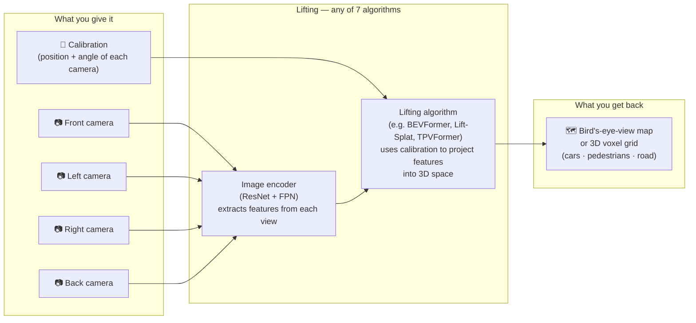

> **Why not just use one front camera?** A single view misses objects to the side and behind. BEV lifting gives a complete 360° spatial picture a planner can act on.

**Pure-PyTorch 2D → BEV / 3D lifting for robotics and autonomous driving.**

TPVFormer, BEVFormer, Lift-Splat-Shoot, Simple-BEV, TIIM and friends, rewritten without
`mmcv`, `mmdet3d`, custom CUDA kernels or compiled ops. Every lifter shares one interface and is
verified to learn from camera geometry on procedurally rendered 3D scenes.

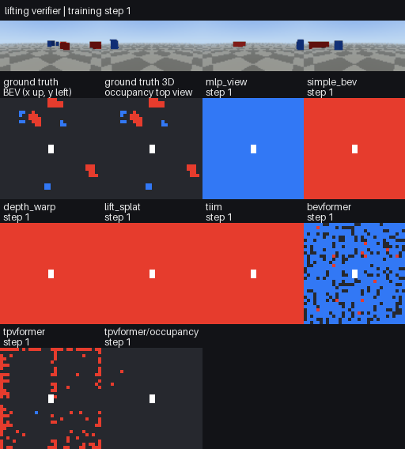

*The verifier trains every lifter on synthetic multi-camera scenes where the camera rig is
randomly rotated in each scene. Top: the 4 camera views. Tiles: ground truth, the geometry-free
baseline, and each lifter's BEV prediction as training progresses. The final frame rotates the
extrinsics while keeping the images fixed; every geometric lifter must then fail.*

---

## Install

```bash
# with uv (recommended)
uv add "halos-lift @ git+https://github.com/basaanithanaveenkumar/Halos-lift"
# or pip
pip install "git+https://github.com/basaanithanaveenkumar/Halos-lift"
# optional torchvision ResNet backbones
uv add "halos-lift[vision] @ git+https://github.com/basaanithanaveenkumar/Halos-lift"
```

The distribution is called `halos-lift` and the import name is `lifting`:
`from lifting import build_bev_model`.

The only dependencies are `torch`, `numpy` and `pillow`. The library runs on CPU, CUDA and MPS.

## 30-second tour

```python
import torch
from lifting import GridSpec, Cameras, build_bev_model, build_tpvformer

grid = GridSpec(x_bounds=(-16, 16), y_bounds=(-16, 16), z_bounds=(-1, 3), resolution=(32, 32, 4))
cameras = Cameras(
    intrinsics=K,            # (B, N, 3, 3) pixel-from-camera
    cam_to_ego=T,            # (B, N, 4, 4) camera (OpenCV) -> ego (x fwd, y left, z up)
    image_size=(H, W),
)

# BEV semantic segmentation with ANY lifter
model = build_bev_model("bevformer", grid, num_classes=3, image_size=(H, W), num_cameras=N)
logits = model(images, cameras)["logits"]            # (B, 3, X, Y)

# TPVFormer 3D semantic occupancy + point queries
tpv = build_tpvformer(grid, num_classes=3)
out = tpv(images, cameras, points=lidar_xyz)         # voxel_logits (B,3,X,Y,Z), point_logits (B,3,P)
```

Use a lifter on its own with your own encoder:

```python
from lifting import LIFTERS
lifter = LIFTERS.build("lift_splat", grid=grid, in_channels=128, out_channels=128)
bev = lifter(features, cameras)   # features: list of (B, N, C, H_l, W_l), fine -> coarse
```

## Lifters

| name | class | paper / origin | how it lifts |
|---|---|---|---|
| `simple_bev` | `BilinearSamplingLifter` | Simple-BEV, `simple_bev/nets/segnet.py` | project voxel centres, bilinear-sample, compress height |
| `depth_warp` | `DepthWarpLifter` | `simple_bev/nets/liftnet.py` | depth-weighted frustum volume, *pulled* per voxel (trilinear) |
| `lift_splat` | `LiftSplatLifter` | Lift-Splat-Shoot, `simple_bev/nets/liftnet2.py` | depth distribution × context, *splatted* by voxel pooling |
| `bevformer` | `BEVFormerLifter` | BEVFormer, `simple_bev/nets/bevformernet{,2}.py` | BEV queries + deformable self-attn + spatial cross-attn over pillar anchors (single- or multi-scale) |
| `tiim` | `PolarRayLifter` | Translating Images into Maps, `simple_bev/nets/tiimnet.py` | column transformer → polar rays → resampled onto the Cartesian grid |
| `tpvformer` | `TPVFormerLifter` | TPVFormer (wzzheng/TPVFormer) | three orthogonal planes, cross-view hybrid attention + per-plane image cross-attention |
| `mlp_view` | `MLPViewLifter` | VPN-style | geometry-free view MLP, used as the **negative control** |

### Pure-PyTorch ops and attention (2D and 3D)

| component | replaces |
|---|---|
| `ops.multi_scale_deformable_attn_2d` | `MultiScaleDeformableAttnFunction` CUDA kernel |
| `ops.multi_scale_deformable_attn_3d` | volumetric (trilinear) version for voxel pyramids |
| `ops.voxel_pooling` | LSS `QuickCumsum` / Simple-BEV `VoxelsSumming` |
| `attention.MSDeformableAttention2D` | Deformable-DETR / BEVFormer temporal & self attention |
| `attention.MSDeformableAttention3D` | multi-scale deformable attention over 3D volumes |
| `attention.PillarDeformableAttention` | BEVFormer/TPVFormer `MSDeformableAttention3D` (multi-anchor, into images) |
| `attention.SpatialCrossAttention` | BEVFormer / TPVFormer image cross-attention |
| `attention.CrossViewHybridAttention` | TPVFormer cross-view hybrid attention |
| `lifters.BEVToTPV` | BEV map → `TPVPlanes`, so any BEV lifter can feed `TPVAggregator` (inverse of `HeightCompressor`) |
| `lifters.PlaneAuxHead` | per-plane classifier; `build_tpvformer(..., aux_heads=True)` + `OccupancyTask(aux_weight=0.5)` supervises each plane |

The ops are checked against explicit loop implementations and with `torch.autograd.gradcheck`.

<!-- triplane:start -->
## Triplane (TPV) lifting for every technique

Every lifter also has a **triplane** version in `lifting.triplane`: it returns three orthogonal planes
`xy (B,C,X,Y)` (= BEV), `xz (B,C,X,Z)`, `yz (B,C,Y,Z)` and decodes any 3D point as
`f(x,y,z) = xy(x,y) + xz(x,z) + yz(y,z)`. Height is kept at 13.8× fewer cells than voxels (`200×200×16`).
**The triplane module does not modify the BEV lifters** (the only edits to existing code are the Alpamayo bug fixes in [`docs/triplane.md`](docs/triplane.md#fixed-issues)): each triplane lifter wraps the BEV lifter, and is itself still a
`BaseLifter` (its `forward()` returns BEV read off the planes), so it works with the existing models, trainer and
verifier. Full documentation: [`docs/triplane.md`](docs/triplane.md) · notebooks: [`notebooks/triplane/`](notebooks/triplane/).

```python
from lifting.triplane import TRIPLANE_LIFTERS, build_triplane_model, build_triplane_bev_model
lifter = TRIPLANE_LIFTERS.build("lift_splat", grid=grid, in_channels=64, out_channels=64)
planes = lifter.lift_planes(features, cameras)                    # TPVPlanes(xy, xz, yz)
occ = build_triplane_model("tiim", grid, num_classes=3)            # 3D occupancy + point queries, any technique
bev = build_triplane_bev_model("bevformer", grid, num_classes=3, num_levels=2)  # BEVFormer V2 triplane, BEV seg
```

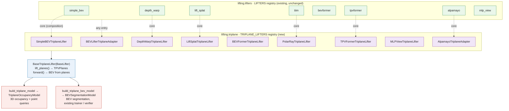

| name | triplane class | how the three planes are produced |
|---|---|---|
| `simple_bev` | `SimpleBEVTriplaneLifter` | For every voxel: project its centre into every camera, bilinearly read the feature there, average over the cameras that see it - then collapse the volume along Z, Y and X. |
| `depth_warp` | `DepthWarpTriplaneLifter` | Predict a depth distribution for every pixel, build a depth-weighted frustum per camera, and let every voxel PULL its feature from the frustum at its (u, v, depth) - then collapse along Z, Y and X. |
| `lift_splat` | `LiftSplatTriplaneLifter` | Lift every pixel to D weighted 3D points (depth probability × context), splat (scatter-sum) the point cloud into voxels, and shoot by collapsing the volume along Z, Y and X. |
| `tiim` | `PolarRayTriplaneLifter` | A transformer turns every image column into a polar ray of depth cells; every voxel reads the ray at its (column, range) AND the image at its (column, row) for height - then collapse along Z, Y and X. |
| `bevformer` | `BEVFormerTriplaneLifter` | One BEVFormer spatial encoder per plane: learned queries on xy, xz and yz, each owning a line of 3D anchors along its plane normal, read the cameras with deformable spatial cross-attention. |
| `tpvformer` | `TPVFormerTriplaneLifter` | Natively a triplane lifter: XY + XZ + YZ learned query tokens alternate cross-view hybrid attention (planes talk to each other) and image cross-attention (anchors projected into the cameras). |
| `alpamayo` | `AlpamayoTriplaneAdapter` | TPVFormer layers whose plane cells follow a Mip-NeRF 360 non-linear parametrisation - dense near the ego, coarse far away - and whose planes are patchified into a fixed-length token sequence for a VLA policy. |
| `mlp_view` | `MLPViewTriplaneLifter` | One fully connected layer per (camera, plane) maps the image cells straight to plane cells; calibration is ignored - the control that proves every other triplane lifter really uses the cameras. |
| `bev_adapter` | `BEVLifterTriplaneAdapter` | Run any registered BEV lifter unchanged, then expand its BEV map into three planes with the learned BEVToTPV: xy from the map, xz / yz from pooled columns expanded along height. |

**Occupancy results** (150 CPU steps, `16×16×4` grid, randomly rotated 4-camera rig; from
`00_triplane_overview.ipynb`). Every geometric triplane lifter learns and collapses when the extrinsics are rotated
by 90°; the geometry-free control cannot localise objects:

| triplane lifter | params (model) | mIoU untrained | mIoU trained ↑ | mIoU, cameras yawed 90° ↓ | CPU time | uses geometry |
|---|---|---|---|---|---|---|
| `lift_splat` | 521k | 0.004 | **0.388** | 0.028 | 5.5 s | ✅ |
| `tiim` | 865k | 0.004 | **0.386** | 0.031 | 6.8 s | ✅ |
| `depth_warp` | 521k | 0.004 | **0.386** | 0.029 | 5.1 s | ✅ |
| `bev_adapter` | 240k | 0.013 | **0.381** | 0.031 | 7.0 s | ✅ |
| `simple_bev` | 510k | 0.000 | **0.375** | 0.030 | 4.3 s | ✅ |
| `alpamayo` | 236k | 0.018 | **0.344** | 0.030 | 7.8 s | ✅ |
| `tpvformer` | 236k | 0.017 | **0.324** | 0.030 | 5.5 s | ✅ |
| `bevformer` | 249k | 0.008 | **0.295** | 0.030 | 6.5 s | ✅ |
| `mlp_view (control)` | 318k | 0.013 | **0.038** | 0.038 | 3.4 s | — (control) |

### Step-by-step animations and diagrams

Each GIF plays the lifting steps of one technique on a toy scene (exact geometry; rendered by
`python scripts/make_triplane_gifs.py`). Expand a card for the explanation and the detailed Mermaid diagram.

#### 1. Simple-BEV - `simple_bev`

> For every voxel: project its centre into every camera, bilinearly read the feature there, average over the cameras that see it - then collapse the volume along Z, Y and X.


<details>
<summary><b>How it lifts + detailed diagram</b> · notebook <code>notebooks/triplane/01_simple_bev_triplane.ipynb</code></summary>

Simple-BEV showed that the simplest possible lifting works remarkably well: **no depth estimation and no attention**.
Each voxel centre `(x, y, z)` is projected into each camera with the calibration; the image feature at that pixel is
read bilinearly; the reads of all cameras that see the voxel are averaged. The result is a dense `(B, C, X, Y, Z)`
volume in which a feature is *smeared along the whole camera ray* (every voxel on the ray reads the same pixel) - the
network learns to resolve depth later from multiple views and context.

The BEV lifter then folds `Z` into channels to get a BEV map. **The triplane version keeps everything up to the
voxel volume** (`BilinearSamplingLifter.unproject`, unchanged and parameter-free) and replaces the single BEV
compressor by `VoxelToTriplane`, which collapses the same volume along `Z` (→ `xy`), `Y` (→ `xz`) and `X` (→ `yz`).
Because the volume is genuinely 3D, all three planes are geometrically grounded: a pixel high up in the image
lands in high voxels and therefore in the upper rows of `xz` / `yz`.

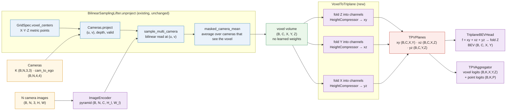

</details>

#### 2. Depth-Warp - `depth_warp`

> Predict a depth distribution for every pixel, build a depth-weighted frustum per camera, and let every voxel PULL its feature from the frustum at its (u, v, depth) - then collapse along Z, Y and X.


<details>
<summary><b>How it lifts + detailed diagram</b> · notebook <code>notebooks/triplane/02_depth_warp_triplane.ipynb</code></summary>

Simple-BEV smears a pixel along its whole ray. **Depth-Warp** fixes that with a learned **depth distribution**:
a `DepthHead` predicts, for every pixel, a softmax over `D` depth bins and a context feature. Their outer product is a
**frustum volume** `(C', D, H, W)` per camera: the context is placed mostly at the depths the network believes in.

Every voxel is then projected to `(u, v, depth)` and samples that frustum **trilinearly** ("pull" / backward warping).
A voxel only receives a strong feature if the network put probability mass at *its* depth.

The triplane version reuses `DepthWarpLifter.frustum_volume` and `DepthWarpLifter.warp` unchanged and swaps the
BEV compressor for `VoxelToTriplane`. Because the depth distribution concentrates features at the right range, the
`xz` / `yz` planes see sharp objects instead of rays.

```mermaid
flowchart LR
  IMG["N camera images<br/>(B, N, 3, H, W)"]:::data --> ENC["ImageEncoder<br/>pyramid (B, N, C, H_l, W_l)"]:::learned
  CAM["Cameras<br/>K (B,N,3,3) · cam_to_ego (B,N,4,4)"]:::data
  subgraph CORE["DepthWarpLifter (existing, unchanged)"]
    direction TB
    DH["DepthHead<br/>softmax over D bins + context C'"]:::learned --> FR["frustum_volume<br/>context ⊗ depth → (B,N,C',D,H,W)"]:::reused
    VC["voxel centres"]:::geo --> PRJ["Cameras.project<br/>(u, v, depth) per voxel"]:::geo
    FR --> WARP["warp: trilinear grid_sample<br/>of the frustum at (u, v, d)<br/>voxels PULL from frustums"]:::geo
    PRJ --> WARP
    WARP --> AVG["masked_camera_mean"]:::geo
  end
  ENC --> DH
  CAM --> PRJ
  AVG --> VOX["voxel volume (B, C', X, Y, Z)"]:::reused
  subgraph V2T["VoxelToTriplane (new)"]
    direction TB
    CXY["fold Z into channels<br/>HeightCompressor → xy"]:::learned
    CXZ["fold Y into channels<br/>HeightCompressor → xz"]:::learned
    CYZ["fold X into channels<br/>HeightCompressor → yz"]:::learned
  end
  VOX --> CXY & CXZ & CYZ
  CXY & CXZ & CYZ --> TPV
  TPV["TPVPlanes<br/>xy (B,C,X,Y) · xz (B,C,X,Z) · yz (B,C,Y,Z)"]:::out
  TPV --> BEVH["TriplaneBEVHead<br/>f = xy + xz + yz → fold Z<br/>BEV (B, C, X, Y)"]:::learned
  TPV --> AGG["TPVAggregator<br/>voxel logits (B,K,X,Y,Z)<br/>+ point logits (B,K,P)"]:::learned
  classDef data fill:#fff7e6,stroke:#d48806,color:#222
  classDef geo fill:#eaf2fb,stroke:#1f77b4,color:#222
  classDef learned fill:#f1e6f8,stroke:#8e44ad,color:#222
  classDef reused fill:#eaf7ea,stroke:#2e8b57,color:#222
  classDef out fill:#fdecea,stroke:#c0392b,color:#222
```

</details>

#### 3. Lift-Splat-Shoot - `lift_splat`

> Lift every pixel to D weighted 3D points (depth probability × context), splat (scatter-sum) the point cloud into voxels, and shoot by collapsing the volume along Z, Y and X.


<details>
<summary><b>How it lifts + detailed diagram</b> · notebook <code>notebooks/triplane/03_lift_splat_triplane.ipynb</code></summary>

Lift-Splat-Shoot is the **push** counterpart of Depth-Warp:

1. **Lift** - every pixel `(u, v)` and depth bin `d` becomes a 3D point `Cameras.unproject(u, v, d)` carrying the
   feature `p(d | u, v) · c(u, v)`. That is `D · h · w` points per camera.
2. **Splat** - every point is added to the voxel it falls in (`voxel_pooling`, scatter-sum). Mass is conserved: the
   sum of the voxel volume equals the sum of all in-grid point features (checked below).
3. **Shoot** - originally: a BEV CNN. Here: `VoxelToTriplane` collapses the splatted volume into `xy`, `xz` and `yz`.

The depth head, the frustum points and the splat are `LiftSplatLifter`'s, unchanged.

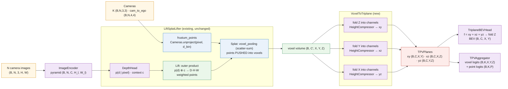

</details>

#### 4. TIIM (polar rays) - `tiim`

> A transformer turns every image column into a polar ray of depth cells; every voxel reads the ray at its (column, range) AND the image at its (column, row) for height - then collapse along Z, Y and X.


<details>
<summary><b>How it lifts + detailed diagram</b> · notebook <code>notebooks/triplane/04_tiim_triplane.ipynb</code></summary>

TIIM treats lifting as **sequence-to-sequence translation**: an image *column* (a vertical strip of `h` pixels) is
encoded by a transformer, and `D` learned depth queries decode it into a **polar ray** - `D` features, one per range
bin, along that column's viewing direction. Stacking all columns gives a polar map `(C, D, W)` per camera.

The polar ray has **consumed the row axis** - it knows *how far* things are along the column, not *how high*. The BEV
lifter is fine with that (it samples the rays at one height). For a 3D triplane that is not enough, so
`PolarRayTriplaneLifter.polar_to_voxels` gives every voxel **two** features:

1. **range feature** - the polar ray sampled at the voxel's column `u` and depth `d` (TIIM's learned depth reasoning);
2. **elevation feature** - the image feature at the voxel's pixel `(u, v)`: the row `v` encodes the voxel's height.

Both are averaged over the cameras that see the voxel and concatenated (`2C` channels), then collapsed into the three
planes. `image_to_polar` is `PolarRayLifter`'s, unchanged.

```mermaid
flowchart LR
  IMG["N camera images<br/>(B, N, 3, H, W)"]:::data --> ENC["ImageEncoder<br/>pyramid (B, N, C, H_l, W_l)"]:::learned
  CAM["Cameras<br/>K (B,N,3,3) · cam_to_ego (B,N,4,4)"]:::data
  subgraph CORE["PolarRayLifter.image_to_polar (existing, unchanged)"]
    direction TB
    COL["every image column<br/>H tokens + row embedding"]:::geo --> TENC["column TransformerEncoder"]:::learned
    TENC --> TDEC["ray TransformerDecoder<br/>D learned depth queries"]:::learned
    TDEC --> POL["polar rays (B, N, C, D, W)<br/>range × column, height consumed"]:::reused
  end
  ENC --> COL
  subgraph P2V["polar_to_voxels (new)"]
    direction TB
    PRJ["Cameras.project voxel centres<br/>→ column u, row v, depth d"]:::geo
    RNG["range feature<br/>grid_sample polar at (u, d)"]:::geo
    ELV["elevation feature<br/>bilinear image read at (u, v)"]:::geo
    PRJ --> RNG & ELV
    RNG & ELV --> CAT["camera-mean + concat → 2C"]:::geo
  end
  CAM --> PRJ
  POL --> RNG
  ENC --> ELV
  CAT --> VOX["voxel volume (B, 2C, X, Y, Z)"]:::reused
  subgraph V2T["VoxelToTriplane (new)"]
    direction TB
    CXY["fold Z into channels<br/>HeightCompressor → xy"]:::learned
    CXZ["fold Y into channels<br/>HeightCompressor → xz"]:::learned
    CYZ["fold X into channels<br/>HeightCompressor → yz"]:::learned
  end
  VOX --> CXY & CXZ & CYZ
  CXY & CXZ & CYZ --> TPV
  TPV["TPVPlanes<br/>xy (B,C,X,Y) · xz (B,C,X,Z) · yz (B,C,Y,Z)"]:::out
  TPV --> BEVH["TriplaneBEVHead<br/>f = xy + xz + yz → fold Z<br/>BEV (B, C, X, Y)"]:::learned
  TPV --> AGG["TPVAggregator<br/>voxel logits (B,K,X,Y,Z)<br/>+ point logits (B,K,P)"]:::learned
  classDef data fill:#fff7e6,stroke:#d48806,color:#222
  classDef geo fill:#eaf2fb,stroke:#1f77b4,color:#222
  classDef learned fill:#f1e6f8,stroke:#8e44ad,color:#222
  classDef reused fill:#eaf7ea,stroke:#2e8b57,color:#222
  classDef out fill:#fdecea,stroke:#c0392b,color:#222
```

</details>

#### 5. BEVFormer (V1 + V2 multi-scale) - `bevformer`

> One BEVFormer spatial encoder per plane: learned queries on xy, xz and yz, each owning a line of 3D anchors along its plane normal, read the cameras with deformable spatial cross-attention.


<details>
<summary><b>How it lifts + detailed diagram</b> · notebook <code>notebooks/triplane/05_bevformer_triplane.ipynb</code></summary>

BEVFormer does not build a voxel volume at all. It owns one **learned query per BEV cell**. Each query has a *pillar*
of `A` 3D anchors at different heights; the anchors are projected into every camera with the calibration
(`Cameras.project`), and **spatial cross-attention** samples a few learned offsets around each projected anchor
(multi-scale deformable attention). An in-plane **deformable self-attention** lets neighbouring queries share context.

Nothing in a BEVFormer layer is specific to the ground plane: self-attention only needs the plane shape and cell
centres, cross-attention only needs projected anchors. So `BEVFormerTriplaneLifter` runs **three** BEVFormer encoders
(`PlaneQueryEncoder`, each a stack of the existing `BEVFormerLayer`):

* `xy` queries own **pillars along z** - exactly `BEVFormerLifter`;
* `xz` queries own **lines along y**; `yz` queries own **lines along x**.

The anchors come from `TPVReferencePoints` (same geometry as TPVFormer). The planes never talk to each other - that is
what TPVFormer adds (notebook `06`) - so this is the *independent planes* ablation of TPVFormer.

**BEVFormer V2 (multi-scale)** in this repo is the same lifter reading **two pyramid levels** (`num_levels=2`): a
learned `level_embed` is added per level and the deformable attention samples both scales. The notebook builds the V2 triplane
and checks that gradients now reach both levels.

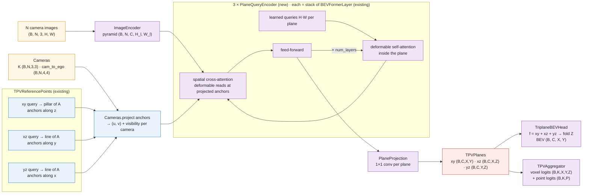

</details>

#### 6. TPVFormer - `tpvformer`

> Natively a triplane lifter: XY + XZ + YZ learned query tokens alternate cross-view hybrid attention (planes talk to each other) and image cross-attention (anchors projected into the cameras).


<details>
<summary><b>How it lifts + detailed diagram</b> · notebook <code>notebooks/triplane/06_tpvformer_triplane.ipynb</code></summary>

TPVFormer *is* the triplane method: it introduced the tri-perspective view. `TPVFormerLifter.lift_planes` already
returns `TPVPlanes`, so `TPVFormerTriplaneLifter` only wraps it (unchanged) and adds a per-plane `1×1` projection so
every triplane lifter shares one contract (`in_channels → out_channels`, BEV from `TriplaneBEVHead`).

Each layer does:

1. **Cross-view hybrid attention** - all `XY + XZ + YZ` tokens form one sequence. A query on one plane fixes two
   coordinates; the third is set to the middle of its axis. The query then samples (deformably) the **same 3D location
   on all three planes** - this is how a pedestrian seen on `xy` informs the height rows of `xz` and `yz`.
2. **Image cross-attention** - like BEVFormer, with anchors along each plane normal projected into the cameras.
3. **Feed-forward**.

Compared with notebook 05 (three independent BEVFormer encoders), the only difference is step 1 - the notebook trains both and
compares them.

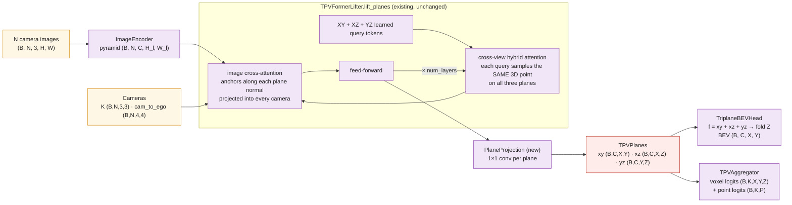

</details>

#### 7. Alpamayo (Mip-NeRF 360 triplane) - `alpamayo`

> TPVFormer layers whose plane cells follow a Mip-NeRF 360 non-linear parametrisation - dense near the ego, coarse far away - and whose planes are patchified into a fixed-length token sequence for a VLA policy.


<details>
<summary><b>How it lifts + detailed diagram</b> · notebook <code>notebooks/triplane/07_alpamayo_triplane.ipynb</code></summary>

Alpamayo uses the TPVFormer architecture as the perception tokenizer of a driving VLA. Two changes:

1. **Non-uniform cells** - `MipNeRF360Parametrizer` gives each axis an *inner* zone (`inner_frac = 75 %` of the
   cells, uniformly spaced in the central part of the extent) and *outer* zones whose fewer cells cover the remaining
   range. Plane queries are therefore dense near the ego vehicle and coarse at long range, without a hard range cutoff.
   Anchors along the plane normal stay uniform so each query still owns a full pillar / line.
2. **Tokens** - `patchify_planes` cuts each plane into `p × p` patches; the three planes give a fixed number of
   tokens, independent of the number of cameras (288 tokens for a `96 × 96 × 48` grid with `p = 8`).

`AlpamayoTriplaneAdapter` wraps the existing `AlpamayoTriplaneLifter` (unchanged) behind the triplane contract and
re-exposes `patchify_planes`.

*Caveats on this toy benchmark:* (1) plane cells follow the parametrisation but the occupancy labels live on the
uniform grid, so outer cells are compared against labels at a slightly different metric location; (2) the existing
`MipNeRF360Parametrizer` has a known issue at small resolutions, shown and explained in the notebook. Both are left untouched
here (the triplane module must not change existing lifters) - the adapter simply wraps what is there.

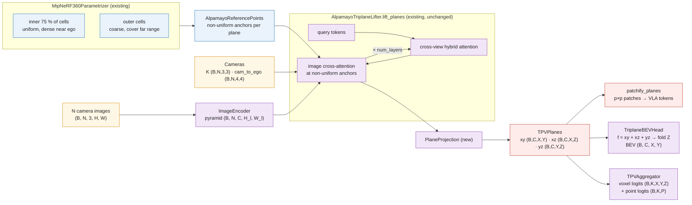

</details>

#### 8. MLP view transform (negative control) - `mlp_view`

> One fully connected layer per (camera, plane) maps the image cells straight to plane cells; calibration is ignored - the control that proves every other triplane lifter really uses the cameras.


<details>
<summary><b>How it lifts + detailed diagram</b> · notebook <code>notebooks/triplane/08_mlp_view_triplane.ipynb</code></summary>

VPN-style view parsing learns the image → plane mapping **from data alone**: for every camera and every plane, a
`Linear(h·w → H_P·W_P)` maps the flattened image cells to the plane cells (channels are shared), and cameras are
summed. There is no projection, no depth, no anchor - `uses_geometry = False`.

This is valuable as a **negative control**. In this repo's synthetic world every scene has a randomly rotated rig, so
"pixel (u, v) of camera 0" points in a different direction in every scene; a mapping that ignores the extrinsics
cannot localise objects. A triplane lifter that does *not* clearly beat this one is not using geometry. And since it
ignores the cameras, corrupting the extrinsics changes nothing (checked exactly in the notebook).

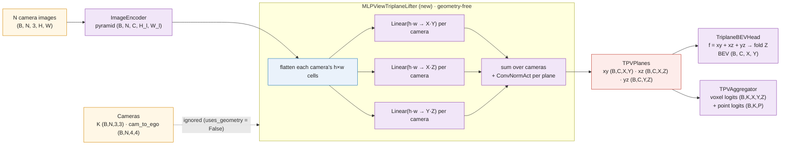

</details>

#### 9. BEV-lifter adapter (any LIFTERS entry → triplane) - `bev_adapter`

> Run any registered BEV lifter unchanged, then expand its BEV map into three planes with the learned BEVToTPV: xy from the map, xz / yz from pooled columns expanded along height.


<details>
<summary><b>How it lifts + detailed diagram</b> · notebook <code>notebooks/triplane/09_bev_adapter_triplane.ipynb</code></summary>

The dedicated triplane lifters (notebooks 01-07) recover height **from the images**. Sometimes you just want TPV
outputs from a BEV lifter you already have - including one you registered yourself. `BEVLifterTriplaneAdapter` does:

1. `LIFTERS.build(base, ...)` - **any** registered BEV lifter, untouched, produces a BEV map `(B, C, X, Y)`;
2. `BEVToTPV` (existing module) turns it into planes:
   * `xy` = two `ConvNormAct` on the BEV map;
   * `xz` = BEV averaged over `y`, then a `1×1` conv expands every `x` column into `Z` height cells;
   * `yz` = BEV averaged over `x`, expanded the same way.

Height is **not** in a BEV map, so `xz` / `yz` are learned *guesses* from what is in each column (e.g. "a vehicle is
~1.6 m tall"). The adapter inherits `uses_geometry` from the wrapped lifter, and `resolve_kwargs` forwards the build
context (`feature_size`, `num_cameras`, `depth_bins`) to it - so `build_triplane_lifter("bev_adapter", ...,
base="mlp_view")` just works.

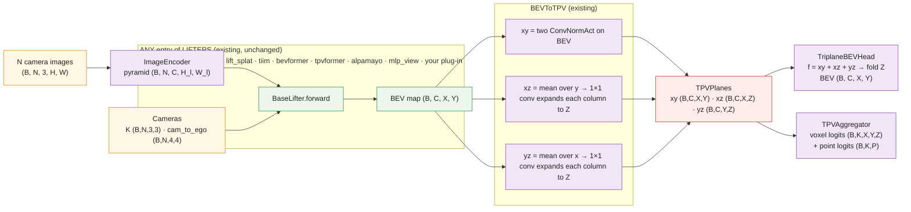

</details>

<!-- triplane:end -->

## Verification: does each lifter really lift?

```bash
lifting-verify --gif verification.gif --json report.json     # ~5 min on a laptop CPU
```

The verifier renders multi-camera scenes with an exact ray caster (`lifting.data`): a checkerboard
ground, sky, and yaw-rotated vehicle and pedestrian boxes. It also produces exact BEV and 3D
occupancy labels. Every lifter is trained end to end on BEV semantic segmentation, and TPVFormer
is also trained on **3D semantic occupancy**. A lifter passes only if all of these hold:

1. **beats_baseline**: its mIoU beats the geometry-free `mlp_view` control by ≥ 0.15. The whole
   camera rig is randomly rotated in every scene, so no model can succeed without the calibration.
2. **uses_geometry**: when the extrinsics are rotated by 90° (images and labels unchanged), its
   mIoU drops by ≥ 50%.
3. **loss_decreases**: its smoothed training loss falls by ≥ 30%.

The GIF is written only when the verification passes. Latest CPU run (300 steps, 32×32×4 grid,
4 cameras at 48×96):

| lifter | task | mIoU ↑ | mIoU with rotated extrinsics ↓ | loss start → end | CPU time | checks |
|---|---|---|---|---|---|---|
| `mlp_view` (control) | BEV | 0.000 | 0.000 | 1.046 → 0.555 | 13 s | baseline |
| `simple_bev` | BEV | 0.510 | 0.016 | 0.990 → 0.133 | 12 s | ✅ ✅ ✅ |
| `depth_warp` | BEV | 0.493 | 0.016 | 0.866 → 0.129 | 16 s | ✅ ✅ ✅ |
| `lift_splat` | BEV | 0.456 | 0.015 | 0.866 → 0.147 | 16 s | ✅ ✅ ✅ |
| `tiim` | BEV | 0.404 | 0.017 | 1.042 → 0.178 | 16 s | ✅ ✅ ✅ |
| `bevformer` | BEV | 0.528 | 0.016 | 0.916 → 0.122 | 28 s | ✅ ✅ ✅ |
| `tpvformer` | BEV | 0.522 | 0.016 | 0.821 → 0.121 | 39 s | ✅ ✅ ✅ |
| `tpvformer` | 3D occupancy | 0.418 | 0.016 | 0.589 → 0.087 | 40 s | ✅ ✅ ✅ |

mIoU is the mean over the foreground classes (vehicle, pedestrian). The full JSON is in
[`assets/verification_report.json`](assets/verification_report.json).

## Training at scale: torchrun, Ray Train and WebDataset

```bash
lifting-train --lifter bevformer --steps 2000                                  # one process
torchrun --nproc_per_node 4 -m lifting.train_cli --lifter lift_splat            # DDP on one node
lifting-train --lifter tpvformer --model triplane --ray --ray-num-workers 8 --ray-use-gpu   # Ray Train
lifting-train --lifter depth_warp --depth-weight 0.05 --webdataset --webdataset-root /fast/shards
```

`lifting-train` trains any lifter (BEV segmentation, or 3D occupancy with its triplane version)
data-parallel with the same `Trainer` step used everywhere else. `--ray` runs it on Ray Train
workers and `--webdataset` renders the scenes once into tar shards and streams them. Both come
from HaleBlocks as optional extras (`pip install -e '.[distributed]'`). Details:
[`docs/distributed.md`](docs/distributed.md).

## Tests

```bash
uv run pytest -m "not slow"     # unit + lifting + integration + training + verifier tests
uv run pytest -m slow           # the full verification as a test
```

| suite | what it proves |
|---|---|
| `tests/unit` | cameras, grid, ops vs naive loops, gradcheck, attention modules, registry, encoders, metric |
| `tests/lifting` | **analytic lifting probes**: with pixel/depth *ramp* features each lifter must return, for every voxel, the exact pixel/depth where it is seen; Lift-Splat puts mass in the right voxel; 90° rig rotation ⇒ 90° rotated volume (equivariance); BEVFormer/TPV reference points are projected pillars/lines; TPV plane ↔ voxel ↔ point consistency |
| `tests/data` | the renderer is geometrically exact (ground pixels unproject to z=0, box pixels onto the box), labels match objects |
| `tests/integration` | every lifter end-to-end with gradients reaching the encoder, 6-camera rigs, ResNet + multi-scale BEVFormer, TPVFormer occupancy & points, state-dict round trip, examples |
| `tests/training` | every lifter overfits a batch; TPVFormer occupancy training; depth supervision; `lifting-train` single process, resume, DDP (2 ranks), WebDataset and Ray Train |
| `tests/triplane` | every triplane lifter: plane shapes, BEV read off the planes, gradients, reuse of the unchanged BEV lifter, geometry (rotated rig), occupancy/BEV training, registry parity with `LIFTERS`, animation storyboards |
| `tests/verification` | judging logic, extrinsic corruption, report/JSON/GIF, CLI, full verification (`slow`) |

## Design

```
src/lifting/
├── geometry/      Cameras, GridSpec, DepthBins      (conventions in one place)
├── ops/           pure-PyTorch deformable attention 2D/3D, voxel pooling, camera sampling
├── attention/     deformable attention modules      (one class per file)
├── layers/        ConvNormAct, ResidualBlock, FeedForward, HeightCompressor
├── encoders/      ImageEncoder ABC, SimpleConvEncoder, ResNetEncoder, FPN
├── lifters/       BaseLifter ABC + LIFTERS registry + all lifters (bevformer/, tpvformer/ sub-packages)
├── triplane/      BaseTriplaneLifter + TRIPLANE_LIFTERS: a triplane (TPV) version of every lifter, factories, GIF animations
├── decoders/      BEVDecoder, SegmentationHead
├── models/        BEVSegmentationModel, TPVFormer, factories
├── data/          synthetic world: CameraRig, ObjectSampler, RayCastRenderer, LabelRasterizer, dataset
├── training/      Trainer + Task strategies (BEV segmentation, occupancy)
├── metrics/       IoUMetric
└── verification/  LiftingVerifier, ExtrinsicCorruption, reports, GIF renderer
```

How the code maps to the SOLID principles:

* **Single responsibility**: one class per file. Geometry, sampling, attention, lifting, decoding,
  training and verification are separate packages.
* **Open/closed**: new lifters register with `@LIFTERS.register("name")`; see
  `examples/custom_lifter.py`. Nothing in the library needs editing.
  The triplane module is itself an example: a new package and registry that wraps every lifter
  without editing any of them.
* **Liskov**: every lifter satisfies `BaseLifter.forward(features, cameras) -> (B, C, X, Y)` and
  can be swapped into `BEVSegmentationModel` and the verifier.
* **Interface segregation**: lifters see only feature maps and `Cameras`; the trainer sees only a
  `Task`.
* **Dependency inversion**: models receive their encoder, lifter, decoder and head; the dataset
  receives its rig, sampler and renderer; the trainer receives its task.

### Conventions

* Ego frame: x forward, y left, z up. Camera frame: OpenCV (x right, y down, z forward).
* Pixel `i` covers `[i, i+1)`, which is the same convention as `grid_sample(align_corners=False)`.
  Rescaling intrinsics to any feature level is therefore exact.
* BEV `(B, C, X, Y)`, voxels `(B, C, X, Y, Z)`, TPV planes `xy (X, Y)`, `xz (X, Z)`, `yz (Y, Z)`.

## Credits

Re-implementations based on [TPVFormer](https://github.com/wzzheng/TPVFormer),
[Simple-BEV](https://github.com/aharley/simple_bev), [BEVFormer](https://github.com/fundamentalvision/BEVFormer),
[Lift-Splat-Shoot](https://github.com/nv-tlabs/lift-splat-shoot) and
[Translating Images into Maps](https://github.com/avishkarsaha/translating-images-into-maps).
MIT licensed.
