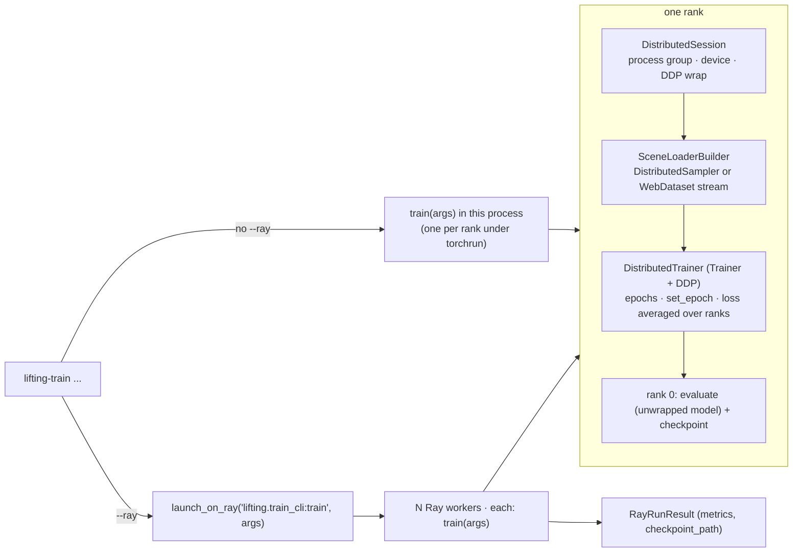

# Distributed training: `lifting-train`, torchrun, Ray Train and WebDataset

`lifting-train` trains any registered lifter on synthetic multi-camera scenes - BEV segmentation
(`--model bev`) or 3D semantic occupancy with the lifter's triplane version (`--model triplane`) -
on one process, under `torchrun`, or on a Ray cluster, optionally streaming the scenes from
WebDataset shards. Ray and WebDataset come from HaleBlocks (`hale_core.distributed.ray`,
`hale_core.data.webdataset`) and are optional extras: `pip install -e '.[distributed]'`
(or `.[ray]` / `.[webdataset]`). Without the flags nothing beyond the core dependencies is needed.



## Building blocks

| class | file | role |
|---|---|---|
| `DistributedSession` | `src/lifting/distributed/session.py` | joins / creates the process group (NCCL on CUDA, Gloo on CPU), picks `cuda:<local_rank>`, wraps the model in DDP, builds `DistributedSampler`s, averages scalars |
| `SceneLoaderBuilder` | `src/lifting/distributed/scene_loader.py` | training loader (sharded, or WebDataset) and rank-0 evaluation loader of `SceneBatch` |
| `DistributedTrainer` | `src/lifting/training/distributed_trainer.py` | `Trainer` subclass: same `train_step`, run through the DDP wrapper; epoch loop, checkpoints (unwrapped weights, atomic writes), resume |
| `launch_on_ray` | `src/lifting/distributed/ray_launch.py` | runs `package.module:function` on Ray Train workers via HaleBlocks' `RayLauncher` |
| `lifting-train` | `src/lifting/train_cli.py` | CLI tying them together |

Design notes:

* **Same step everywhere.** `DistributedTrainer` reuses `Trainer.train_step`, so single-process
  and distributed runs compute the same loss; any `Task` works, including
  `DepthSupervisedTask` (`--depth-weight`).
* **Evaluation on rank 0 with the unwrapped model.** A DDP forward synchronises buffers with the
  other ranks; running it on one rank would hang. Other ranks wait at a barrier.
* **`find_unused_parameters=True`.** Some lifters own parameters a given configuration never
  touches (e.g. an unused pyramid level); DDP would otherwise fail on the first backward pass.
* **Equal steps on every rank.** `DistributedSampler(drop_last)` and resampled WebDataset streams
  give every rank the same number of batches, so all ranks stop at the same step.

## torchrun

```bash
torchrun --nproc_per_node 4 -m lifting.train_cli --lifter bevformer --steps 5000 --batch-size 8
```

`--batch-size` and `--steps` are per rank; each rank reads a disjoint quarter of the scenes.

## Ray Train

```bash
lifting-train --lifter tpvformer --model triplane --ray --ray-num-workers 8 --ray-use-gpu \
    --ray-address auto --ray-storage-path /shared/ray_results --ray-max-failures 3
```

| flag | default | meaning |
|---|---|---|
| `--ray` | off | launch on Ray Train workers |
| `--ray-address` | local Ray | `auto` / `ray://host:10001` to join a cluster |
| `--ray-num-workers` | `1` | training processes (one per GPU) |
| `--ray-use-gpu` | off | one GPU per worker (NCCL); otherwise CPU workers (Gloo) |
| `--ray-cpus-per-worker` | Ray default | CPUs reserved per worker |
| `--ray-storage-path` | `ray_results` | where Ray persists reported checkpoints |
| `--ray-max-failures` | `0` | worker-group restarts after a failure |

Workers import `lifting.train_cli` and call `train(args)` - only the parsed arguments are shipped,
so `halos-lift` must be installed on every node. After each evaluation epoch every rank reports
its metrics and rank 0 attaches the checkpoint directory; after a failure Ray restarts the group
and training resumes from the newest `lift_step*.pt` it restored.

## WebDataset

```bash
lifting-train --lifter lift_splat --webdataset --webdataset-root /fast_disk/shards \
    --webdataset-samples-per-shard 64
```

The first run renders the training scenes once and writes them to
`<root>/synthetic-train-<fingerprint>/shard-*.tar` (+ `manifest.json`); every later run and every
rank streams the shards instead of ray-casting scenes again. Samples round-trip exactly (images,
intrinsics, extrinsics, labels, occupancy and depth including `inf` sky pixels). The fingerprint
hashes `--train-scenes`, `--resolution` and `--seed`; other flags reuse the shards. Only rank 0
converts; with several ranks each rank resamples shards so all ranks run the same number of steps.
Validation always reads the scenes directly on rank 0, so every scene is scored exactly once.

| flag | default | meaning |
|---|---|---|
| `--webdataset` | off | convert + stream |
| `--webdataset-root` | `data/webdataset` | shard root |
| `--webdataset-samples-per-shard` | `64` | samples per tar; keep ≥ ranks × `--num-workers` shards |
| `--webdataset-convert-workers` | `0` | parallel scene rendering while converting |
| `--webdataset-shuffle-buffer` | `256` | in-memory sample shuffle |
| `--webdataset-overwrite` | off | re-convert even if valid shards exist |

## Tests

`tests/training/test_distributed_training.py`: single process (evaluation, checkpoints without a
`module.` prefix), resume, BEV / triplane / depth-supervised runs, JSON output, WebDataset
(converts once, reuses), 2-rank DDP over Gloo, and Ray Train with 2 workers. The WebDataset and Ray
tests are skipped when the extras are not installed.
