# Triplane (TPV) lifting for every technique

`lifting.triplane` adds a **tri-perspective-view** output to every lifting technique in Halos-lift.
A triplane lifter returns three orthogonal feature planes instead of one bird's-eye-view map:

| plane | shape | view |
|---|---|---|
| `xy` | `(B, C, X, Y)` | top - this **is** the BEV map |
| `xz` | `(B, C, X, Z)` | side |
| `yz` | `(B, C, Y, Z)` | front |

and any 3D point is decoded from $f(x, y, z) = xy(x, y) + xz(x, z) + yz(y, z)$ (Huang et al., TPVFormer, CVPR 2023).
For a `200 × 200 × 16` region that is 46,400 cells instead of 640,000 voxels (13.8× fewer) while keeping height,
which a BEV map (40,000 cells) loses.

**The triplane module does not modify the existing lifters** (the only edits to existing code are the Alpamayo bug fixes under *Fixed issues*). The module is a separate package with its own registry. Each triplane lifter
*wraps* the existing BEV lifter (composition, `self.core`) and adds only what is needed to keep the height axis.

Contents: [design](#design) · [API](#api) · [techniques](#techniques) · [results](#results) ·
[notebooks](#notebooks) · [animations](#animations) · [extending](#adding-a-triplane-lifter) · [known issues](#known-issues)

## Design

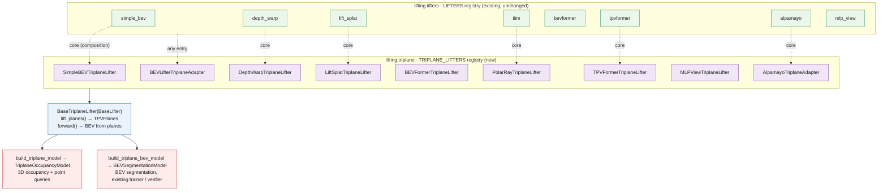

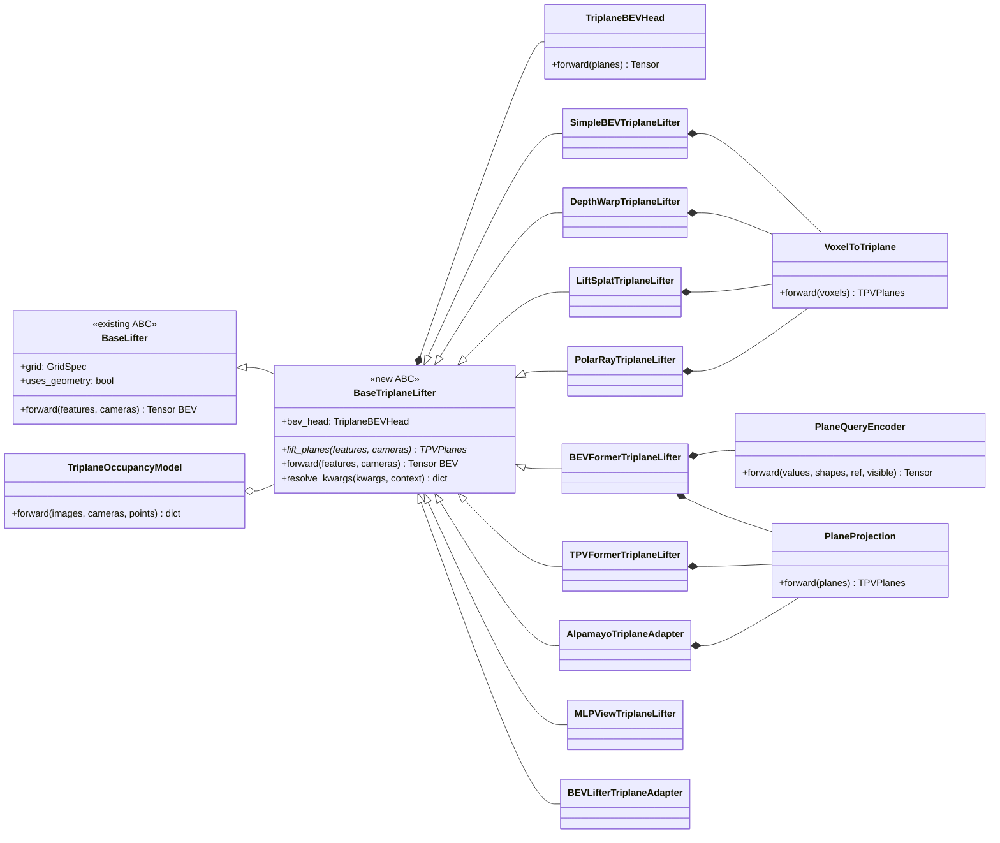

| principle | how the triplane module follows it |
|---|---|
| **Single responsibility** | one class per file: `VoxelToTriplane` only collapses axes, `PlaneQueryEncoder` only runs one plane's queries, `PlaneProjection` only maps channels, `TriplaneBEVHead` only reads a BEV map off the planes, each lifter only wires its technique |
| **Open / closed** | new registry `TRIPLANE_LIFTERS`; existing lifters are wrapped, never edited; new techniques register with `@TRIPLANE_LIFTERS.register(name)` |
| **Liskov** | `BaseTriplaneLifter` *is a* `BaseLifter`: `forward()` still returns `(B, C, X, Y)` (computed from the planes), so every triplane lifter drops into `BEVSegmentationModel`, `Trainer` and `LiftingVerifier` |
| **Interface segregation** | one abstract method, `lift_planes(features, cameras) -> TPVPlanes`; consumers that only need BEV call `forward` |
| **Dependency inversion** | `TriplaneOccupancyModel` receives its encoder, lifter and aggregator; factories inject context (`feature_size`, `num_cameras`, `depth_bins`) through `resolve_kwargs` |

```
src/lifting/triplane/
├── base.py                     BaseTriplaneLifter ABC + TRIPLANE_LIFTERS registry
├── plane_compressor.py         VoxelToTriplane        (B,C,X,Y,Z) -> xy / xz / yz
├── plane_query_encoder.py      PlaneQueryEncoder      BEVFormer encoder for any plane
├── plane_projection.py         PlaneProjection        per-plane 1x1 conv
├── triplane_bev_head.py        TriplaneBEVHead        planes -> voxels -> BEV
├── simple_bev_triplane.py      SimpleBEVTriplaneLifter
├── depth_warp_triplane.py      DepthWarpTriplaneLifter
├── lift_splat_triplane.py      LiftSplatTriplaneLifter
├── polar_ray_triplane.py       PolarRayTriplaneLifter (TIIM)
├── bevformer_triplane.py       BEVFormerTriplaneLifter (V1, and V2 with num_levels=2)
├── tpvformer_triplane.py       TPVFormerTriplaneLifter
├── alpamayo_triplane.py        AlpamayoTriplaneAdapter
├── mlp_view_triplane.py        MLPViewTriplaneLifter  (negative control)
├── bev_lifter_adapter.py       BEVLifterTriplaneAdapter (any LIFTERS entry)
├── triplane_occupancy_model.py TriplaneOccupancyModel
├── factory.py                  build_triplane_lifter / build_triplane_model / build_triplane_bev_model
└── animation/                  Pillow-only step-by-step GIFs (one storyboard per technique)
```

### Sequence: one forward pass

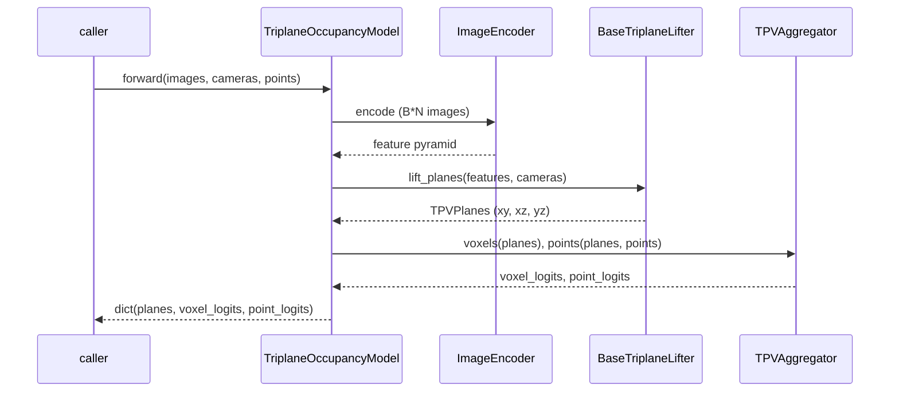

## API

```python
from lifting.triplane import (
    TRIPLANE_LIFTERS,
    build_triplane_lifter,
    build_triplane_model,
    build_triplane_bev_model,
)

# the lifter alone: features = list of (B, N, C, H_l, W_l), fine -> coarse
lifter = TRIPLANE_LIFTERS.build("lift_splat", grid=grid, in_channels=64, out_channels=64)
planes = lifter.lift_planes(features, cameras)  # TPVPlanes(xy, xz, yz)
bev = lifter(features, cameras)  # (B, 64, X, Y)

# with context injection (feature_size / num_cameras / depth_bins), like lifting.models.build_lifter
lifter = build_triplane_lifter(
    "mlp_view", grid, 64, image_size=(48, 96), num_cameras=4, encoder=encoder
)

# 3D semantic occupancy + point queries with ANY technique (TPVFormer head, trains with OccupancyTask)
model = build_triplane_model("tiim", grid, num_classes=3, aux_heads=True)
out = model(images, cameras, points=lidar_xyz)  # planes, voxel_logits, point_logits, aux_logits

# BEV segmentation read off the planes (same signature as lifting.build_bev_model)
bev_model = build_triplane_bev_model(
    "bevformer", grid, num_classes=3, num_levels=2
)  # BEVFormer V2 triplane

# any BEV lifter, including your own registered one
adapter = TRIPLANE_LIFTERS.build(
    "bev_adapter", grid=grid, in_channels=64, out_channels=64, base="my_lifter"
)
```

| name | class | wraps (unchanged) | new parts |
|---|---|---|---|
| `simple_bev` | `SimpleBEVTriplaneLifter` | `BilinearSamplingLifter.unproject` | `VoxelToTriplane` |
| `depth_warp` | `DepthWarpTriplaneLifter` | `DepthWarpLifter.frustum_volume`, `.warp` | `VoxelToTriplane` |
| `lift_splat` | `LiftSplatTriplaneLifter` | `LiftSplatLifter.depth_head`, `.splat` | `VoxelToTriplane` |
| `tiim` | `PolarRayTriplaneLifter` | `PolarRayLifter.image_to_polar` | voxel range + elevation read, `VoxelToTriplane` |
| `bevformer` | `BEVFormerTriplaneLifter` | `BEVFormerLayer`, `TPVReferencePoints` | one `PlaneQueryEncoder` per plane, `PlaneProjection` |
| `tpvformer` | `TPVFormerTriplaneLifter` | `TPVFormerLifter.lift_planes` | `PlaneProjection` |
| `alpamayo` | `AlpamayoTriplaneAdapter` | `AlpamayoTriplaneLifter.lift_planes`, `.patchify_planes` | `PlaneProjection`, resampling onto uniform cells |
| `mlp_view` | `MLPViewTriplaneLifter` | - (geometry-free, mirrors `MLPViewLifter`) | one `Linear(h·w → H_P·W_P)` per (camera, plane) |
| `bev_adapter` | `BEVLifterTriplaneAdapter` | any `LIFTERS` entry + `BEVToTPV` | - (composition only) |
| `bev_side` | `BEVSideTriplaneLifter` | `lift_voxels` of `simple_bev` / `depth_warp` / `lift_splat` / `tiim` | two `AxisAttentionPool`s, `BEVSideMixer`; **no `yz` plane** |

## Techniques

1. [Simple-BEV](#1-simple-bev---simple_bev--simplebevtriplanelifter)
2. [Depth-Warp](#2-depth-warp---depth_warp--depthwarptriplanelifter)
3. [Lift-Splat-Shoot](#3-lift-splat-shoot---lift_splat--liftsplattriplanelifter)
4. [TIIM (polar rays)](#4-tiim-polar-rays---tiim--polarraytriplanelifter)
5. [BEVFormer (V1 + V2 multi-scale)](#5-bevformer-v1--v2-multi-scale---bevformer--bevformertriplanelifter)
6. [TPVFormer](#6-tpvformer---tpvformer--tpvformertriplanelifter)
7. [Alpamayo (Mip-NeRF 360 triplane)](#7-alpamayo-mip-nerf-360-triplane---alpamayo--alpamayotriplaneadapter)
8. [MLP view transform (negative control)](#8-mlp-view-transform-negative-control---mlp_view--mlpviewtriplanelifter)
9. [BEV-lifter adapter (any LIFTERS entry → triplane)](#9-bev-lifter-adapter-any-lifters-entry--triplane---bev_adapter--bevliftertriplaneadapter)
10. [BEV + side, no front view (two-plane TPV)](#10-bev--side-no-front-view---bev_side--bevsidetriplanelifter)

### 1. Simple-BEV - `simple_bev` → `SimpleBEVTriplaneLifter`

*Harley et al., *Simple-BEV* (ICRA 2023) · `segnet.py`* · notebook [`notebooks/triplane/01_simple_bev_triplane.ipynb`](../notebooks/triplane/01_simple_bev_triplane.ipynb)

> For every voxel: project its centre into every camera, bilinearly read the feature there, average over the cameras that see it - then collapse the volume along Z, Y and X.


Simple-BEV showed that the simplest possible lifting works remarkably well: **no depth estimation and no attention**.
Each voxel centre `(x, y, z)` is projected into each camera with the calibration; the image feature at that pixel is
read bilinearly; the reads of all cameras that see the voxel are averaged. The result is a dense `(B, C, X, Y, Z)`
volume in which a feature is *smeared along the whole camera ray* (every voxel on the ray reads the same pixel) - the
network learns to resolve depth later from multiple views and context.

The BEV lifter then folds `Z` into channels to get a BEV map. **The triplane version keeps everything up to the
voxel volume** (`BilinearSamplingLifter.unproject`, unchanged and parameter-free) and replaces the single BEV
compressor by `VoxelToTriplane`, which collapses the same volume along `Z` (→ `xy`), `Y` (→ `xz`) and `X` (→ `yz`).
Because the volume is genuinely 3D, all three planes are geometrically grounded: a pixel high up in the image
lands in high voxels and therefore in the upper rows of `xz` / `yz`.

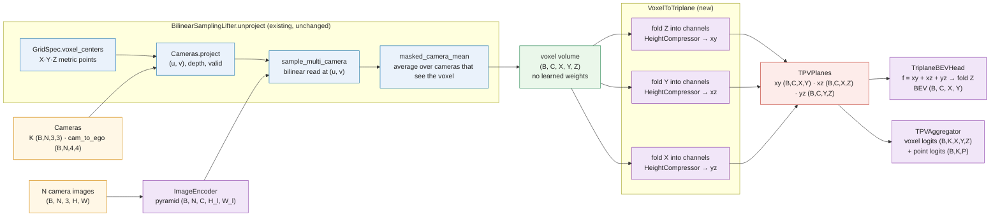

For voxel centre $p = (x, y, z)$ and camera $n$ with intrinsics $K_n$ and ego→camera transform $(R_n, t_n)$:

$$ \tilde u = K_n (R_n p + t_n), \qquad (u, v) = (\tilde u_0 / \tilde u_2,\ \tilde u_1 / \tilde u_2), \qquad
V(p) = \frac{\sum_n m_n(p)\, \mathrm{bilinear}(F_n, u, v)}{\max(1, \sum_n m_n(p))} $$

where $m_n(p) = 1$ if the point is in front of camera $n$ and inside its image. Then

$$ xy = \mathrm{Conv}_{C\cdot Z \to C}(V),\quad xz = \mathrm{Conv}_{C\cdot Y \to C}(V^{\top}),\quad yz = \mathrm{Conv}_{C\cdot X \to C}(V^{\top\top}) $$

| tensor | shape |
|---|---|
| features (level 0) | `(B, N, C, H/4, W/4)` |
| voxel volume `V` | `(B, C, X, Y, Z)` |
| planes | `xy (B, C, X, Y)`, `xz (B, C, X, Z)`, `yz (B, C, Y, Z)` |


### 2. Depth-Warp - `depth_warp` → `DepthWarpTriplaneLifter`

*Harley et al., Simple-BEV `liftnet.py` (depth-based warp)* · notebook [`notebooks/triplane/02_depth_warp_triplane.ipynb`](../notebooks/triplane/02_depth_warp_triplane.ipynb)

> Predict a depth distribution for every pixel, build a depth-weighted frustum per camera, and let every voxel PULL its feature from the frustum at its (u, v, depth) - then collapse along Z, Y and X.

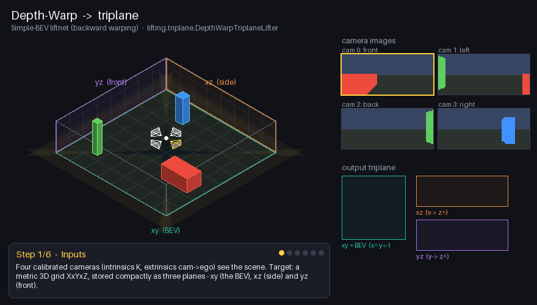

Simple-BEV smears a pixel along its whole ray. **Depth-Warp** fixes that with a learned **depth distribution**:
a `DepthHead` predicts, for every pixel, a softmax over `D` depth bins and a context feature. Their outer product is a
**frustum volume** `(C', D, H, W)` per camera: the context is placed mostly at the depths the network believes in.

Every voxel is then projected to `(u, v, depth)` and samples that frustum **trilinearly** ("pull" / backward warping).
A voxel only receives a strong feature if the network put probability mass at *its* depth.

The triplane version reuses `DepthWarpLifter.frustum_volume` and `DepthWarpLifter.warp` unchanged and swaps the
BEV compressor for `VoxelToTriplane`. Because the depth distribution concentrates features at the right range, the
`xz` / `yz` planes see sharp objects instead of rays.

```mermaid
flowchart LR
  IMG["N camera images<br/>(B, N, 3, H, W)"]:::data --> ENC["ImageEncoder<br/>pyramid (B, N, C, H_l, W_l)"]:::learned
  CAM["Cameras<br/>K (B,N,3,3) · cam_to_ego (B,N,4,4)"]:::data
  subgraph CORE["DepthWarpLifter (existing, unchanged)"]
    direction TB
    DH["DepthHead<br/>softmax over D bins + context C'"]:::learned --> FR["frustum_volume<br/>context ⊗ depth → (B,N,C',D,H,W)"]:::reused
    VC["voxel centres"]:::geo --> PRJ["Cameras.project<br/>(u, v, depth) per voxel"]:::geo
    FR --> WARP["warp: trilinear grid_sample<br/>of the frustum at (u, v, d)<br/>voxels PULL from frustums"]:::geo
    PRJ --> WARP
    WARP --> AVG["masked_camera_mean"]:::geo
  end
  ENC --> DH
  CAM --> PRJ
  AVG --> VOX["voxel volume (B, C', X, Y, Z)"]:::reused
  subgraph V2T["VoxelToTriplane (new)"]
    direction TB
    CXY["fold Z into channels<br/>HeightCompressor → xy"]:::learned
    CXZ["fold Y into channels<br/>HeightCompressor → xz"]:::learned
    CYZ["fold X into channels<br/>HeightCompressor → yz"]:::learned
  end
  VOX --> CXY & CXZ & CYZ
  CXY & CXZ & CYZ --> TPV
  TPV["TPVPlanes<br/>xy (B,C,X,Y) · xz (B,C,X,Z) · yz (B,C,Y,Z)"]:::out
  TPV --> BEVH["TriplaneBEVHead<br/>f = xy + xz + yz → fold Z<br/>BEV (B, C, X, Y)"]:::learned
  TPV --> AGG["TPVAggregator<br/>voxel logits (B,K,X,Y,Z)<br/>+ point logits (B,K,P)"]:::learned
  classDef data fill:#fff7e6,stroke:#d48806,color:#222
  classDef geo fill:#eaf2fb,stroke:#1f77b4,color:#222
  classDef learned fill:#f1e6f8,stroke:#8e44ad,color:#222
  classDef reused fill:#eaf7ea,stroke:#2e8b57,color:#222
  classDef out fill:#fdecea,stroke:#c0392b,color:#222
```

$$ (\,p_\theta(d \mid u, v),\ c(u, v)\,) = \mathrm{DepthHead}(F_n), \qquad
\Phi_n(c', d, v, u) = c(u, v)_{c'} \cdot p_\theta(d \mid u, v) $$

$$ V(p) = \operatorname{mean}_{n:\,m_n(p)} \ \mathrm{trilinear}\big(\Phi_n,\ u_n(p),\ v_n(p),\ d_n(p)\big) $$

| tensor | shape |
|---|---|
| depth probabilities | `(B·N, D, h, w)`, sums to 1 over `D` |
| frustum `Φ` | `(B, N, C', D, h, w)` |
| voxel volume | `(B, C', X, Y, Z)` |


### 3. Lift-Splat-Shoot - `lift_splat` → `LiftSplatTriplaneLifter`

*Philion & Fidler, *Lift, Splat, Shoot* (ECCV 2020)* · notebook [`notebooks/triplane/03_lift_splat_triplane.ipynb`](../notebooks/triplane/03_lift_splat_triplane.ipynb)

> Lift every pixel to D weighted 3D points (depth probability × context), splat (scatter-sum) the point cloud into voxels, and shoot by collapsing the volume along Z, Y and X.

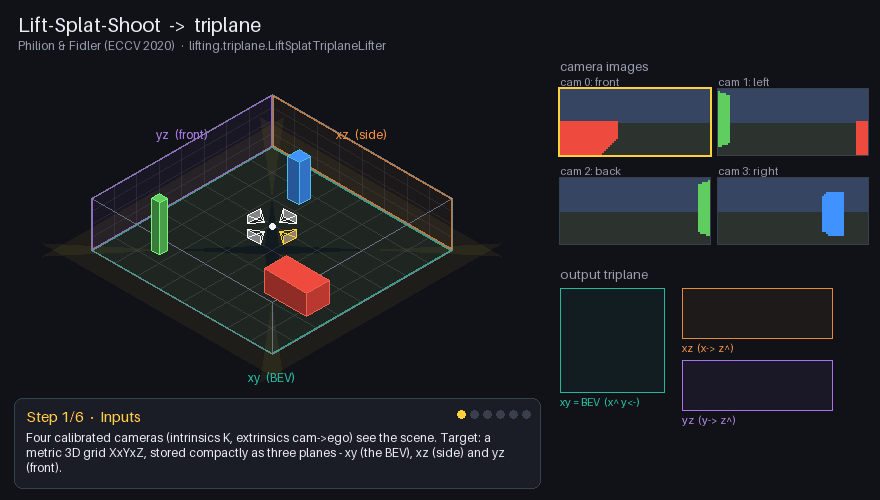

Lift-Splat-Shoot is the **push** counterpart of Depth-Warp:

1. **Lift** - every pixel `(u, v)` and depth bin `d` becomes a 3D point `Cameras.unproject(u, v, d)` carrying the
   feature `p(d | u, v) · c(u, v)`. That is `D · h · w` points per camera.
2. **Splat** - every point is added to the voxel it falls in (`voxel_pooling`, scatter-sum). Mass is conserved: the
   sum of the voxel volume equals the sum of all in-grid point features (checked below).
3. **Shoot** - originally: a BEV CNN. Here: `VoxelToTriplane` collapses the splatted volume into `xy`, `xz` and `yz`.

The depth head, the frustum points and the splat are `LiftSplatLifter`'s, unchanged.

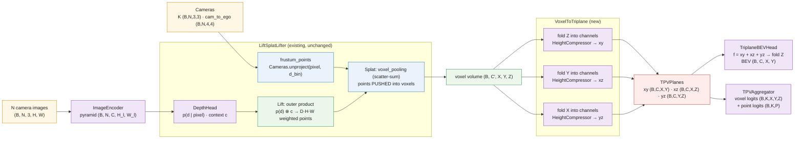

$$ P_{n,d,u,v} = \mathrm{unproject}_n(u, v, d), \qquad f_{n,d,u,v} = p_\theta(d \mid u, v)\, c(u, v) $$

$$ V[i, j, k] = \sum_{n,d,u,v} \mathbb{1}\big[P_{n,d,u,v} \in \mathrm{voxel}(i, j, k)\big]\ f_{n,d,u,v} $$

| tensor | shape |
|---|---|
| depth / context | `(B, N, D, h, w)` / `(B, N, C', h, w)` |
| frustum points | `(B, N, D·h·w, 3)` metric |
| voxel volume | `(B, C', X, Y, Z)` (sum-pooled) |


### 4. TIIM (polar rays) - `tiim` → `PolarRayTriplaneLifter`

*Saha et al., *Translating Images into Maps* (ICRA 2022) · `tiimnet.py`* · notebook [`notebooks/triplane/04_tiim_triplane.ipynb`](../notebooks/triplane/04_tiim_triplane.ipynb)

> A transformer turns every image column into a polar ray of depth cells; every voxel reads the ray at its (column, range) AND the image at its (column, row) for height - then collapse along Z, Y and X.

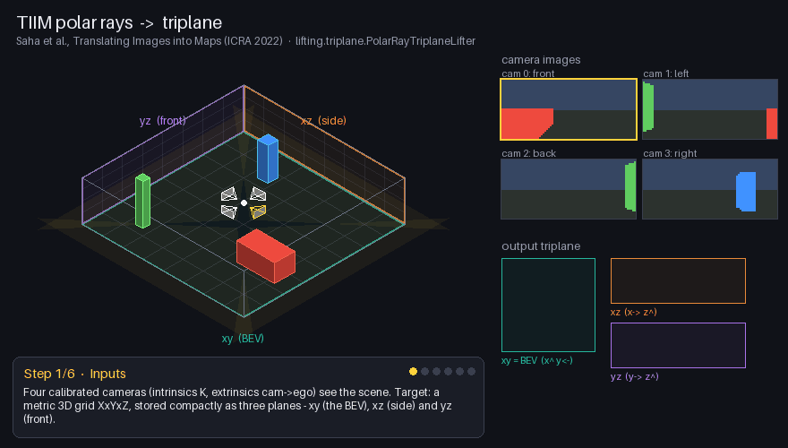

TIIM treats lifting as **sequence-to-sequence translation**: an image *column* (a vertical strip of `h` pixels) is
encoded by a transformer, and `D` learned depth queries decode it into a **polar ray** - `D` features, one per range
bin, along that column's viewing direction. Stacking all columns gives a polar map `(C, D, W)` per camera.

The polar ray has **consumed the row axis** - it knows *how far* things are along the column, not *how high*. The BEV
lifter is fine with that (it samples the rays at one height). For a 3D triplane that is not enough, so
`PolarRayTriplaneLifter.polar_to_voxels` gives every voxel **two** features:

1. **range feature** - the polar ray sampled at the voxel's column `u` and depth `d` (TIIM's learned depth reasoning);
2. **elevation feature** - the image feature at the voxel's pixel `(u, v)`: the row `v` encodes the voxel's height.

Both are averaged over the cameras that see the voxel and concatenated (`2C` channels), then collapsed into the three
planes. `image_to_polar` is `PolarRayLifter`'s, unchanged.

```mermaid
flowchart LR
  IMG["N camera images<br/>(B, N, 3, H, W)"]:::data --> ENC["ImageEncoder<br/>pyramid (B, N, C, H_l, W_l)"]:::learned
  CAM["Cameras<br/>K (B,N,3,3) · cam_to_ego (B,N,4,4)"]:::data
  subgraph CORE["PolarRayLifter.image_to_polar (existing, unchanged)"]
    direction TB
    COL["every image column<br/>H tokens + row embedding"]:::geo --> TENC["column TransformerEncoder"]:::learned
    TENC --> TDEC["ray TransformerDecoder<br/>D learned depth queries"]:::learned
    TDEC --> POL["polar rays (B, N, C, D, W)<br/>range × column, height consumed"]:::reused
  end
  ENC --> COL
  subgraph P2V["polar_to_voxels (new)"]
    direction TB
    PRJ["Cameras.project voxel centres<br/>→ column u, row v, depth d"]:::geo
    RNG["range feature<br/>grid_sample polar at (u, d)"]:::geo
    ELV["elevation feature<br/>bilinear image read at (u, v)"]:::geo
    PRJ --> RNG & ELV
    RNG & ELV --> CAT["camera-mean + concat → 2C"]:::geo
  end
  CAM --> PRJ
  POL --> RNG
  ENC --> ELV
  CAT --> VOX["voxel volume (B, 2C, X, Y, Z)"]:::reused
  subgraph V2T["VoxelToTriplane (new)"]
    direction TB
    CXY["fold Z into channels<br/>HeightCompressor → xy"]:::learned
    CXZ["fold Y into channels<br/>HeightCompressor → xz"]:::learned
    CYZ["fold X into channels<br/>HeightCompressor → yz"]:::learned
  end
  VOX --> CXY & CXZ & CYZ
  CXY & CXZ & CYZ --> TPV
  TPV["TPVPlanes<br/>xy (B,C,X,Y) · xz (B,C,X,Z) · yz (B,C,Y,Z)"]:::out
  TPV --> BEVH["TriplaneBEVHead<br/>f = xy + xz + yz → fold Z<br/>BEV (B, C, X, Y)"]:::learned
  TPV --> AGG["TPVAggregator<br/>voxel logits (B,K,X,Y,Z)<br/>+ point logits (B,K,P)"]:::learned
  classDef data fill:#fff7e6,stroke:#d48806,color:#222
  classDef geo fill:#eaf2fb,stroke:#1f77b4,color:#222
  classDef learned fill:#f1e6f8,stroke:#8e44ad,color:#222
  classDef reused fill:#eaf7ea,stroke:#2e8b57,color:#222
  classDef out fill:#fdecea,stroke:#c0392b,color:#222
```

$$ R_n[:, d, w] = \mathrm{Dec}\big(q_d,\ \mathrm{Enc}(F_n[:, :, w] + e_{\mathrm{row}})\big) \quad\text{(polar ray of column } w) $$

$$ V(p) = \Big[\ \operatorname{mean}_n R_n\big(u_n(p), d_n(p)\big)\ \Big\Vert\ \operatorname{mean}_n F_n\big(u_n(p), v_n(p)\big)\ \Big] \in \mathbb{R}^{2C} $$

| tensor | shape |
|---|---|
| column tokens | `(B·N·w, h, C)` |
| polar rays | `(B, N, C, D, w)` |
| voxel volume | `(B, 2C, X, Y, Z)` = `[range ‖ elevation]` |


### 5. BEVFormer (V1 + V2 multi-scale) - `bevformer` → `BEVFormerTriplaneLifter`

*Li et al., *BEVFormer* (ECCV 2022) · Simple-BEV `bevformernet.py` / `bevformernet2.py`* · notebook [`notebooks/triplane/05_bevformer_triplane.ipynb`](../notebooks/triplane/05_bevformer_triplane.ipynb)

> One BEVFormer spatial encoder per plane: learned queries on xy, xz and yz, each owning a line of 3D anchors along its plane normal, read the cameras with deformable spatial cross-attention.

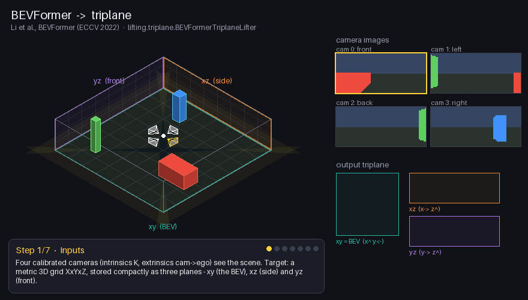

BEVFormer does not build a voxel volume at all. It owns one **learned query per BEV cell**. Each query has a *pillar*
of `A` 3D anchors at different heights; the anchors are projected into every camera with the calibration
(`Cameras.project`), and **spatial cross-attention** samples a few learned offsets around each projected anchor
(multi-scale deformable attention). An in-plane **deformable self-attention** lets neighbouring queries share context.

Nothing in a BEVFormer layer is specific to the ground plane: self-attention only needs the plane shape and cell
centres, cross-attention only needs projected anchors. So `BEVFormerTriplaneLifter` runs **three** BEVFormer encoders
(`PlaneQueryEncoder`, each a stack of the existing `BEVFormerLayer`):

* `xy` queries own **pillars along z** - exactly `BEVFormerLifter`;
* `xz` queries own **lines along y**; `yz` queries own **lines along x**.

The anchors come from `TPVReferencePoints` (same geometry as TPVFormer). The planes never talk to each other - that is
what TPVFormer adds (notebook `06`) - so this is the *independent planes* ablation of TPVFormer.

**BEVFormer V2 (multi-scale)** in this repo is the same lifter reading **two pyramid levels** (`num_levels=2`): a
learned `level_embed` is added per level and the deformable attention samples both scales. The notebook builds the V2 triplane
and checks that gradients now reach both levels.

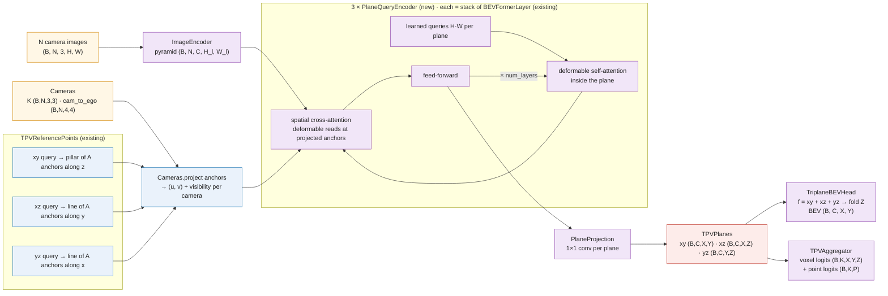

For a query $q$ on plane $P$ with anchors $\{a_{q,k}\}_{k=1..A}$ along the plane normal:

$$ \mathrm{SCA}(q) = \frac{1}{|\mathcal V_q|} \sum_{n \in \mathcal V_q} \sum_{k=1}^{A} \mathrm{MSDeformAttn}\big(q,\ \pi_n(a_{q,k}),\ F_n\big),
\qquad \mathcal V_q = \{ n : \exists k,\ \pi_n(a_{q,k}) \text{ visible} \} $$

$$ q \leftarrow \mathrm{FFN}\Big(\mathrm{SCA}\big(\mathrm{DeformSelfAttn}_P(q)\big)\Big) \quad (\times\ \text{num\_layers}) $$

| tensor | shape |
|---|---|
| queries per plane | `xy: X·Y`, `xz: X·Z`, `yz: Y·Z` (each `C` wide) |
| anchors per plane | `(Q_P, A_P, 3)` with `A = (4, 8, 8)` by default |
| projected anchors | `(B, N, Q_P, A_P, 2)` in `[0, 1]` + visibility `(B, N, Q_P, A_P)` |
| pyramid values | `(B, N, S, C)`, `S = Σ_l H_l W_l` |


### 6. TPVFormer - `tpvformer` → `TPVFormerTriplaneLifter`

*Huang et al., *Tri-Perspective View for Vision-Based 3D Semantic Occupancy Prediction* (CVPR 2023)* · notebook [`notebooks/triplane/06_tpvformer_triplane.ipynb`](../notebooks/triplane/06_tpvformer_triplane.ipynb)

> Natively a triplane lifter: XY + XZ + YZ learned query tokens alternate cross-view hybrid attention (planes talk to each other) and image cross-attention (anchors projected into the cameras).


TPVFormer *is* the triplane method: it introduced the tri-perspective view. `TPVFormerLifter.lift_planes` already
returns `TPVPlanes`, so `TPVFormerTriplaneLifter` only wraps it (unchanged) and adds a per-plane `1×1` projection so
every triplane lifter shares one contract (`in_channels → out_channels`, BEV from `TriplaneBEVHead`).

Each layer does:

1. **Cross-view hybrid attention** - all `XY + XZ + YZ` tokens form one sequence. A query on one plane fixes two
   coordinates; the third is set to the middle of its axis. The query then samples (deformably) the **same 3D location
   on all three planes** - this is how a pedestrian seen on `xy` informs the height rows of `xz` and `yz`.
2. **Image cross-attention** - like BEVFormer, with anchors along each plane normal projected into the cameras.
3. **Feed-forward**.

Compared with notebook 05 (three independent BEVFormer encoders), the only difference is step 1 - the notebook trains both and
compares them.

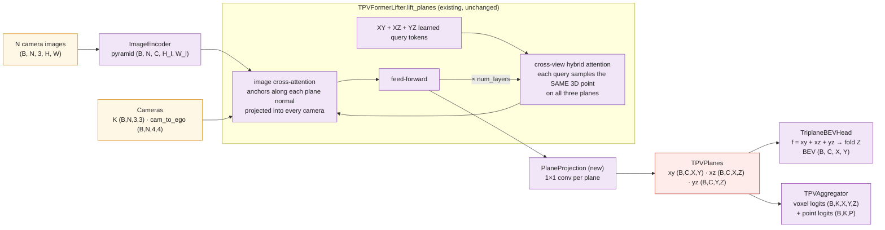

$$ T = [\,Q_{xy};\ Q_{xz};\ Q_{yz}\,] \in \mathbb{R}^{(XY + XZ + YZ) \times C} $$

$$ \mathrm{CVHA}(t) = \sum_{P \in \{xy, xz, yz\}} \mathrm{DeformAttn}\big(t,\ \rho_P(t),\ P\big), \qquad
\rho_P(t) = \text{the 3D location of } t \text{ expressed in plane } P $$

$$ T \leftarrow \mathrm{FFN}\big(\mathrm{ICA}(\mathrm{CVHA}(T))\big) \quad(\times\ \text{num\_layers}), \qquad
f(x, y, z) = xy(x, y) + xz(x, z) + yz(y, z) $$

| tensor | shape |
|---|---|
| tokens | `(B, XY + XZ + YZ, C)` |
| hybrid reference points | `(XY + XZ + YZ, 3, 2)` - one `(col, row)` per plane |
| projected anchors | per plane `(B, N, Q_P, A_P, 2)` |


### 7. Alpamayo (Mip-NeRF 360 triplane) - `alpamayo` → `AlpamayoTriplaneAdapter`

*Ivanovic et al., arXiv:2506.12251 · Alpamayo-R1, arXiv:2511.00088 · Barron et al., *Mip-NeRF 360* (CVPR 2022)* · notebook [`notebooks/triplane/07_alpamayo_triplane.ipynb`](../notebooks/triplane/07_alpamayo_triplane.ipynb)

> TPVFormer layers whose plane cells follow a Mip-NeRF 360 non-linear parametrisation - dense near the ego, coarse far away - and whose planes are patchified into a fixed-length token sequence for a VLA policy.

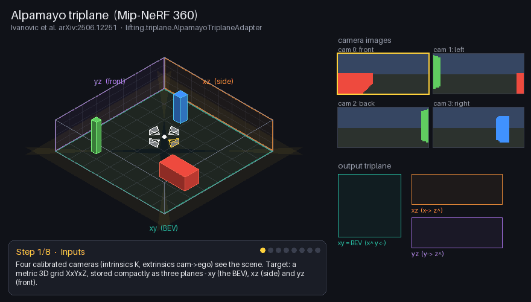

Alpamayo uses the TPVFormer architecture as the perception tokenizer of a driving VLA. Two changes:

1. **Non-uniform cells** - `MipNeRF360Parametrizer` spaces each axis's cells uniformly in Mip-NeRF 360
   *contracted* space: an *inner* zone (`inner_frac = 75 %` of the cells) is linear and narrower than a uniform grid,
   and the *outer* tails widen smoothly with distance up to the grid bounds. Plane queries are therefore dense near
   the ego vehicle and coarse at long range. Anchors along the plane normal stay uniform so each query still owns a
   full pillar / line.
2. **Tokens** - `patchify_planes` cuts each plane into `p × p` patches; the three planes give a fixed number of
   tokens, independent of the number of cameras (288 tokens for a `96 × 96 × 48` grid with `p = 8`).

`AlpamayoTriplaneAdapter` wraps the existing `AlpamayoTriplaneLifter` behind the triplane contract and
re-exposes `patchify_planes`.

**Two plane layouts.** Alpamayo's own planes are non-uniform (cell `i` sits at the parametriser's centre `i`).
`lift_native_planes` returns them - tokenise these with `patchify_planes`. Everything that indexes planes on the
grid (BEV head, `TPVAggregator` voxels / points, plane losses, labels) needs uniform cells, so `lift_planes` resamples
the native planes at the exact continuous index of every uniform cell centre (bilinear; exact in the linear inner
zone). Without this, cell `(i, j)` would be decoded at the wrong metric location.

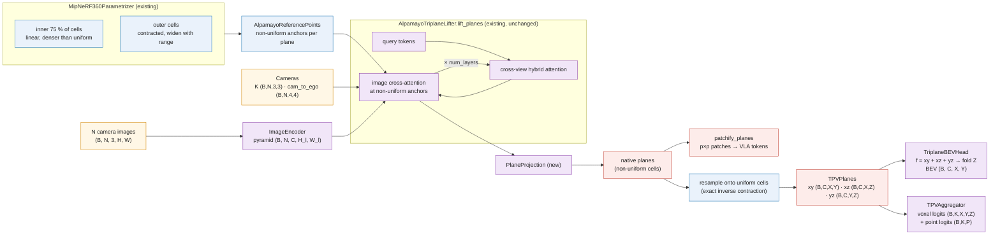

Per axis with $n$ cells over extent $L$ and inner fraction $\phi$: $n_\text{in} = \lfloor \phi n \rfloor$ cells
uniformly in $[-\phi L/2,\ \phi L/2]$, the remaining $n - n_\text{in}$ cells split between both tails.

$$ \text{tokens} = \frac{X Y}{p^2} + \frac{X Z}{p^2} + \frac{Y Z}{p^2}, \qquad \text{token width} = C p^2 $$

| tensor | shape |
|---|---|
| anchors per plane | `(Q_P, A_P, 3)` with non-uniform in-plane coordinates |
| planes | `xy (B,C,X,Y)`, `xz (B,C,X,Z)`, `yz (B,C,Y,Z)` |
| VLA tokens | `(B, N_tokens, C·p²)` |


### 8. MLP view transform (negative control) - `mlp_view` → `MLPViewTriplaneLifter`

*Pan et al., *View Parsing Network* (RA-L 2020) - geometry-free baseline* · notebook [`notebooks/triplane/08_mlp_view_triplane.ipynb`](../notebooks/triplane/08_mlp_view_triplane.ipynb)

> One fully connected layer per (camera, plane) maps the image cells straight to plane cells; calibration is ignored - the control that proves every other triplane lifter really uses the cameras.

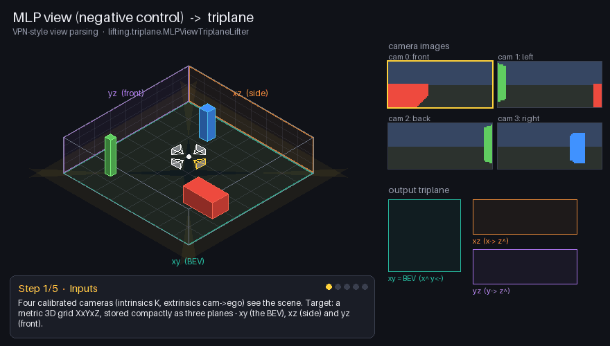

VPN-style view parsing learns the image → plane mapping **from data alone**: for every camera and every plane, a
`Linear(h·w → H_P·W_P)` maps the flattened image cells to the plane cells (channels are shared), and cameras are
summed. There is no projection, no depth, no anchor - `uses_geometry = False`.

This is valuable as a **negative control**. In this repo's synthetic world every scene has a randomly rotated rig, so
"pixel (u, v) of camera 0" points in a different direction in every scene; a mapping that ignores the extrinsics
cannot localise objects. A triplane lifter that does *not* clearly beat this one is not using geometry. And since it
ignores the cameras, corrupting the extrinsics changes nothing (checked exactly in the notebook).

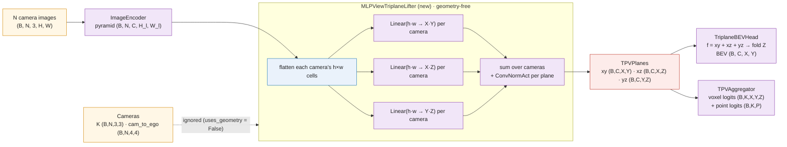

$$ P_{c}[\,i\,] = \sum_{n=1}^{N} \sum_{j=1}^{h w} W^{(P,n)}_{i j}\, F_{n, c}[\,j\,] + b^{(P,n)}_i, \qquad
P \in \{xy, xz, yz\},\ i \in \text{cells of } P $$

followed by `ConvNormAct + 1×1 conv` per plane.

| tensor | shape |
|---|---|
| features (coarsest level) | `(B, N, C, h, w)` |
| view MLP per (plane, camera) | `Linear(h·w, H_P·W_P)` |
| planes | `xy (B,C,X,Y)`, `xz (B,C,X,Z)`, `yz (B,C,Y,Z)` |


### 9. BEV-lifter adapter (any LIFTERS entry → triplane) - `bev_adapter` → `BEVLifterTriplaneAdapter`

*generic: wraps every entry of `lifting.lifters.LIFTERS`, including your own plug-ins* · notebook [`notebooks/triplane/09_bev_adapter_triplane.ipynb`](../notebooks/triplane/09_bev_adapter_triplane.ipynb)

> Run any registered BEV lifter unchanged, then expand its BEV map into three planes with the learned BEVToTPV: xy from the map, xz / yz from pooled columns expanded along height.


The dedicated triplane lifters (notebooks 01-07) recover height **from the images**. Sometimes you just want TPV
outputs from a BEV lifter you already have - including one you registered yourself. `BEVLifterTriplaneAdapter` does:

1. `LIFTERS.build(base, ...)` - **any** registered BEV lifter, untouched, produces a BEV map `(B, C, X, Y)`;
2. `BEVToTPV` (existing module) turns it into planes:
   * `xy` = two `ConvNormAct` on the BEV map;
   * `xz` = BEV averaged over `y`, then a `1×1` conv expands every `x` column into `Z` height cells;
   * `yz` = BEV averaged over `x`, expanded the same way.

Height is **not** in a BEV map, so `xz` / `yz` are learned *guesses* from what is in each column (e.g. "a vehicle is
~1.6 m tall"). The adapter inherits `uses_geometry` from the wrapped lifter, and `resolve_kwargs` forwards the build
context (`feature_size`, `num_cameras`, `depth_bins`) to it - so `build_triplane_lifter("bev_adapter", ...,
base="mlp_view")` just works.

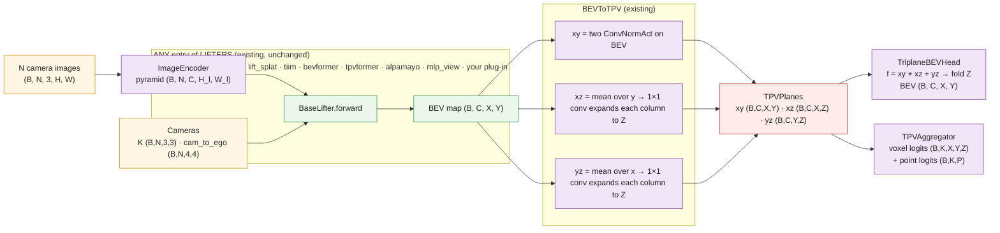

$$ B = \mathrm{Lifter}_\text{base}(F, \text{cams}) \in \mathbb{R}^{C \times X \times Y} $$

$$ xy = \mathrm{CNA}(\mathrm{CNA}(B)),\qquad xz[:, x, z] = \big(W_{xz}\, \tfrac{1}{Y}\textstyle\sum_y B[:, x, y]\big)_{z},\qquad
yz[:, y, z] = \big(W_{yz}\, \tfrac{1}{X}\textstyle\sum_x B[:, x, y]\big)_{z} $$

with $W \in \mathbb{R}^{(C\cdot Z) \times C}$ a `1×1` convolution - the inverse direction of `HeightCompressor`.

| tensor | shape |
|---|---|
| BEV map | `(B, C, X, Y)` |
| pooled columns | `(B, C, X)` and `(B, C, Y)` |
| planes | `xy (B,C,X,Y)`, `xz (B,C,X,Z)`, `yz (B,C,Y,Z)` |


### 10. BEV + side, no front view - `bev_side` → `BEVSideTriplaneLifter`

*two-plane TPV from reused perspective features* · notebook [`notebooks/triplane/10_bev_side_triplane.ipynb`](../notebooks/triplane/10_bev_side_triplane.ipynb)

> Read the cameras once into a voxel volume, pool that same volume over height (BEV) and over the lateral axis (side),
> and let the two planes exchange information along the forward axis they share. The `yz` front plane is never built.

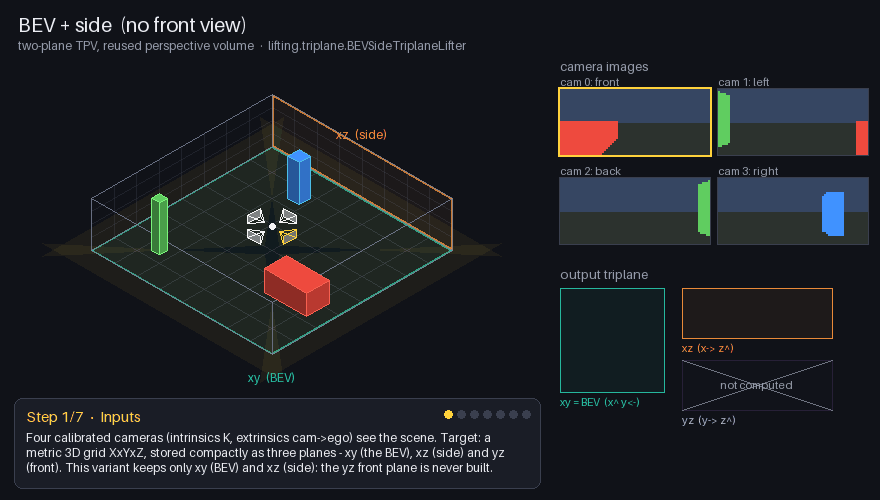

Two departures from the other techniques:

1. **No front plane.** `lift_planes` returns `TPVPlanes(xy, xz, yz=None)` and `lifter.planes == ("xy", "xz")`.
   The voxel feature is `f(x, y, z) = xy(x, y) + xz(x, z)`: `x` is read by both planes, `y` by the BEV plane, `z`
   by the side plane, so every voxel is still addressed on all three axes - only the `(y, z)` coupling that bypasses
   `x` is gone. The representation shrinks from `X·Y + X·Z + Y·Z` to `X·Y + X·Z` cells.
2. **The perspective features are sampled once and reused for both planes.** A voxel-volume lifter (`volume=`:
   `simple_bev` (default), `depth_warp`, `lift_splat` or `tiim` - anything satisfying `VoxelVolumeSource`) turns the
   camera features into a `(B, C, X, Y, Z)` volume; that is the only camera access. `bevformer` / `tpvformer`
   instead run one image cross-attention per plane. The source's own plane compressors and BEV head are dropped,
   so every parameter of the lifter is on the gradient path.

```mermaid
flowchart LR
  IMG["N camera images<br/>(B, N, 3, H, W)"]:::data --> ENC["ImageEncoder<br/>pyramid (B, N, C, H_l, W_l)"]:::learned
  CAM["Cameras<br/>K · cam_to_ego"]:::data
  subgraph VOL["volume lifter (existing, reused): simple_bev | depth_warp | lift_splat | tiim"]
    direction TB
    LV["lift_voxels<br/>project · read · camera mean"]:::reused
  end
  ENC --> LV
  CAM --> LV
  LV --> V["perspective volume V<br/>(B, C, X, Y, Z)<br/>the ONLY camera access"]:::reused
  V --> PH["AxisAttentionPool over Z<br/>pool_height"]:::learned
  V --> PL["AxisAttentionPool over Y<br/>pool_lateral"]:::learned
  PH --> XY["xy (B, C, X, Y)"]:::out
  PL --> XZ["xz (B, C, X, Z)"]:::out
  XY <--> MIX["BEVSideMixer × L<br/>row-wise cross-attention along x"]:::learned
  XZ <--> MIX
  MIX --> TPV["TPVPlanes(xy, xz, yz=None)"]:::out
  TPV --> BEVH["TriplaneBEVHead<br/>f = xy + xz → fold Z → BEV"]:::learned
  TPV --> AGG["TPVAggregator<br/>voxel + point logits"]:::learned
  classDef data fill:#fff7e6,stroke:#d48806,color:#222
  classDef learned fill:#f1e6f8,stroke:#8e44ad,color:#222
  classDef reused fill:#eaf7ea,stroke:#2e8b57,color:#222
  classDef out fill:#fdecea,stroke:#c0392b,color:#222
```

With the shared volume $V$ and learned position embeddings $E$ along the pooled axis:

$$ xy[:, x, y] = W_o \sum_{z} \alpha_{x,y,z}\, W_v\big(V[:, x, y, z] + E^Z_z\big),\qquad
   \alpha_{x,y,\cdot} = \mathrm{softmax}_z\, w^\top\big(V[:, x, y, \cdot] + E^Z\big) $$

$$ xz[:, x, z] = W'_o \sum_{y} \beta_{x,z,y}\, W'_v\big(V[:, x, y, z] + E^Y_y\big) $$

(per head; `pooling="fold"` swaps the attention for the channel-folding `HeightCompressor` used by `simple_bev`).
A `BEVSideMixer` layer treats each row `x` as two short sequences - `Y` BEV cells and `Z` side cells - and runs
cross-attention both ways, then a depthwise-3×3 FFN per plane:

$$ xy_x \leftarrow xy_x + \mathrm{Attn}(xy_x + P^Y,\ xz_x + P^Z,\ xz_x),\qquad
   xz_x \leftarrow xz_x + \mathrm{Attn}(xz_x + P^Z,\ xy_x + P^Y,\ xy_x) $$

| argument | default | meaning |
|---|---|---|
| `volume` | `simple_bev` | triplane lifter whose `lift_voxels` provides the shared volume |
| `volume_kwargs` | `{}` | its constructor arguments (the build context is forwarded automatically) |
| `pooling` | `attention` | `attention` (`AxisAttentionPool`) or `fold` (`HeightCompressor`) |
| `mix_layers` | `2` | `BEVSideMixer` layers (`0` = independent planes) |
| `num_heads` | `4` | heads of the pools and the mixer |

| tensor | shape |
|---|---|
| shared volume `V` | `(B, C, X, Y, Z)` |
| planes | `xy (B,C,X,Y)`, `xz (B,C,X,Z)`, `yz = None` |
| BEV / voxel logits | `(B, C, X, Y)` / `(B, K, X, Y, Z)` (decoded from `xy + xz`) |

**Library support for two-plane TPVs.** `TPVPlanes.yz` is optional everywhere: `to_voxels`, `sample_points`,
`upsample`, `to_tokens` / `from_tokens(names=...)`, `PlaneProjection`, the BEV head and the aggregator use the planes
that exist; `TPVPlanes.names` / `has_front` / `tensors()` describe them. `BaseTriplaneLifter.planes` declares what a
lifter produces; `build_triplane_model(..., aux_heads=True)` puts a parameter-free placeholder in the `yz` aux slot,
`aux_logits[2]` is `None` and `OccupancyTask` skips it.

**Measured** (same protocol as [Results](#results), 2 seeds, mean ± half-range):

| lifter | lifter params | mIoU trained ↑ |
|---|---|---|
| `simple_bev` (three planes, folded) | 335k | 0.371 ± 0.004 |
| `tpvformer` (three planes, one layer) | 61k | 0.334 ± 0.010 |
| `bevformer` (three independent planes, one layer) | 74k | 0.309 ± 0.014 |
| **`bev_side`** (default) | **42k** | **0.345 ± 0.014** |
| `bev_side`, `mix_layers=0` | 5k | 0.359 ± 0.013 |
| `bev_side`, `pooling="fold"` | 223k | 0.356 ± 0.011 |
| `bev_side`, `volume="lift_splat"` | 53k | 0.282 ± 0.008 |

On this toy task two planes from one shared volume beat both three-plane attention lifters with fewer parameters,
and stay within ~0.01-0.03 of the three-plane `simple_bev` that has 8× the lifter parameters. The mixer does not help
within 150 steps (no-mix 0.359 vs 0.345, inside the seed spread), and attention pooling over a sparse splatted
`lift_splat` volume underperforms the folding compressor `lift_splat` uses as a three-plane lifter (0.388). All
variants collapse to ~0.03 with yawed extrinsics, so they read the cameras through the calibration.


## Results

Measured by [`00_triplane_overview.ipynb`](../notebooks/triplane/00_triplane_overview.ipynb): 3D semantic occupancy,
150 AdamW steps, 128 training / 32 test scenes, `16 × 16 × 4` grid, 4 cameras at `48 × 96` with a randomly rotated rig
per scene, query-based lifters with one layer, CPU. "Cameras yawed 90°" evaluates the same trained model with every
extrinsic rotated by 90° (images and labels unchanged).

| triplane lifter | params (model) | mIoU untrained | mIoU trained ↑ | mIoU, cameras yawed 90° ↓ | CPU time | uses geometry |
|---|---|---|---|---|---|---|
| `lift_splat` | 521k | 0.004 | **0.388** | 0.028 | 5.5 s | ✅ |
| `tiim` | 865k | 0.004 | **0.386** | 0.031 | 6.8 s | ✅ |
| `depth_warp` | 521k | 0.004 | **0.386** | 0.029 | 5.1 s | ✅ |
| `bev_adapter` | 240k | 0.013 | **0.381** | 0.031 | 7.0 s | ✅ |
| `simple_bev` | 510k | 0.000 | **0.375** | 0.030 | 4.3 s | ✅ |
| `alpamayo` | 236k | 0.018 | **0.344** | 0.030 | 7.8 s | ✅ |
| `tpvformer` | 236k | 0.017 | **0.324** | 0.030 | 5.5 s | ✅ |
| `bevformer` | 249k | 0.008 | **0.295** | 0.030 | 6.5 s | ✅ |
| `mlp_view (control)` | 318k | 0.013 | **0.038** | 0.038 | 3.4 s | — (control) |
| `bev_side` (two planes, measured separately, seed 0) | 212k | 0.000 | **0.331** | 0.031 | 8.1 s | ✅ |

Every geometric triplane lifter learns and collapses when the calibration is wrong; the geometry-free control cannot
localise objects at all. Notable comparisons from the technique notebooks:

* TPVFormer (planes talk through cross-view hybrid attention) **0.324** vs the same anchors with independent planes
  (`bevformer` triplane) **0.295**.
* BEVFormer V2 triplane (`num_levels=2`) **0.331** vs V1 **0.295**.
* Alpamayo **0.344** vs TPVFormer **0.324**: same layers, Mip-NeRF 360 cells resampled onto the uniform grid.
* These are short single-seed runs on a toy world; use them to compare techniques, not as benchmarks.

## Notebooks

[`notebooks/triplane/`](../notebooks/triplane/) holds one executed notebook per technique plus an overview. Each has
the same structure: idea + GIF + Mermaid diagram + equations → every animation step as a still → the scene → building
the lifter → **inside the lifter, every intermediate tensor with exact checks** → the triplane contract verified →
training on 3D occupancy → negative control with corrupted extrinsics → usage, recap, cheat sheet, exercises.
Shared helpers live in `notebooks/triplane/tpv_kit/` (one class per file).

## Animations

`lifting.triplane.animation` renders the GIFs with Pillow only (no matplotlib), with exact geometry on a toy scene
(4 cameras, a car, a pedestrian, a pole). Each technique is a `Storyboard` subclass in
`animation/storyboards/<name>_storyboard.py`, composed from shared `Step`s.

```bash
python scripts/make_triplane_gifs.py                  # all -> assets/triplane/<name>.gif
python scripts/make_triplane_gifs.py --only tiim bevformer --out /tmp/gifs
```

## Adding a triplane lifter

```python
from lifting.triplane import TRIPLANE_LIFTERS, BaseTriplaneLifter, VoxelToTriplane


@TRIPLANE_LIFTERS.register("my_triplane")
class MyTriplaneLifter(BaseTriplaneLifter):
    def __init__(self, grid, in_channels, out_channels):
        super().__init__(grid, in_channels, out_channels)  # creates the BEV head
        self.core = MyBEVLifter(grid, in_channels, in_channels)  # reuse, don't edit
        self.to_planes = VoxelToTriplane(in_channels, grid, out_channels)

    def lift_planes(self, features, cameras):
        return self.to_planes(self.core.lift_voxels(features, cameras))
```

`forward`, `build_triplane_model`, `build_triplane_bev_model`, the trainer and the verifier work immediately. Verify the
contract with `TriplaneContractChecker(lifter, features, cameras).run()` from `notebooks/triplane/tpv_kit`.

* **Fewer planes.** Set the class attribute `planes = ("xy", "xz")` and return `TPVPlanes(xy, xz)`; everything
  downstream (BEV head, aggregator, aux heads, occupancy loss, contract checker, storyboard `planes`) follows it.
* **Lend your volume.** A lifter with `lift_voxels(features, cameras)` and a `voxel_channels` attribute is a
  `VoxelVolumeSource`, so `bev_side` can reuse it: `TRIPLANE_LIFTERS.build("bev_side", ..., volume="my_triplane")`.

## Fixed issues

* **`MipNeRF360Parametrizer`** used to size its left tail with the inner span (centres out of order at 16 / 32
  cells) and gave the inner zone the same spacing as a uniform grid. It now spaces cells uniformly in Mip-NeRF 360
  contracted space (monotonic, denser near the ego, edges exactly on the bounds), and `AlpamayoReferencePoints`
  centres every axis on its bounds (the default `z ∈ [-1, 3]` was shifted 1 m down). Tests:
  `tests/unit/test_mipnerf360.py`.
* **Depth-based lifters** (`depth_warp`, `lift_splat`) trained on occupancy alone learn almost no depth in short runs.
  `lifting.training.DepthSupervisedTask` wraps any task and adds a BEVDepth-style depth cross-entropy on every
  `DepthHead` (no lifter change); notebooks `02` and `03` measure its effect. Tests:
  `tests/training/test_depth_supervision.py`.
* **Alpamayo planes decoded on the wrong cells.** BEV head, `TPVAggregator` and plane losses index planes on the
  grid's uniform cells, but Alpamayo's planes are non-uniform. `AlpamayoTriplaneAdapter.lift_planes` now resamples
  them onto the uniform grid; `lift_native_planes` keeps the native layout for `patchify_planes`. Test:
  `tests/triplane/test_triplane_components.py::test_alpamayo_planes_are_resampled_onto_the_uniform_grid`.
